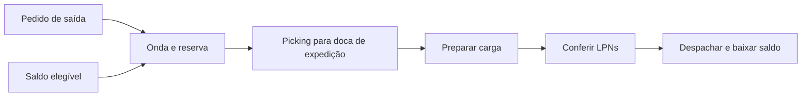

# Guia de integração da API WMS para clientes web e mobile

Este documento reúne os endpoints implementados, seus corpos de requisição, respostas, permissões e a sequência de consumo para construir os clientes. O contrato foi conferido nos controllers, DTOs e serviços do backend em **15/10/2026**, usando o código-base `7abbf76`. Exemplos de IDs e tokens são ilustrativos; substitua-os pelos valores retornados pela API.

## Índice

1. [Conexão, tipos e respostas](#conexao)
2. [Autenticação e sessão](#autenticacao)
3. [Paginação, pesquisa e dropdowns](#consultas)
4. [Permissões e administração](#administracao)
5. [Cadastros](#cadastros)
6. [Recebimento e putaway](#entrada)
7. [Pedidos, ondas, picking e expedição](#saida)
8. [Estoque, transferências, tarefas e auditoria](#estoque)
9. [Inventário](#inventario)
10. [Idempotência e tratamento de erros](#erros)
11. [Organização do consumo nos clientes](#clientes)
12. [Catálogo completo de endpoints](#endpoints)
13. [Dicionário dos payloads e respostas](#modelos)

<a id="conexao"></a>

## 1. Conexão, tipos e respostas

### URL e headers

Use uma `baseUrl` configurável, sem `/api` no final. Na execução local padrão, ela é `http://localhost:8080`; a porta pode ser alterada no ambiente. No dispositivo Android, use o endereço pelo qual o aparelho alcança o backend. `localhost` no aparelho identifica o próprio aparelho.

| Header | Quando enviar | Valor |
| --- | --- | --- |
| `Accept` | Todas as chamadas | `application/json` |
| `Content-Type` | Quando houver corpo JSON | `application/json` |
| `Authorization` | Rotas protegidas | `Bearer <accessToken>` |
| `X-Client-Type` | Login, confirmação de código, refresh e logout | `WEB` ou `MOBILE`; omitido assume `WEB` |
| `Idempotency-Key` | Comandos identificados como `Header` no catálogo | Uma chave exclusiva de até 64 caracteres |

As rotas públicas são `GET /health`, `GET /health/ready` e os `POST` de login, recuperação/redefinição de senha, verificação de desafio, refresh e logout. Refresh e logout validam o refresh token recebido, mesmo dispensando access token. O cadastro `/api/auth/register` é administrativo e exige autenticação e permissões.

No navegador, habilite o envio de credenciais para as chamadas que usam o cookie de refresh (`credentials: "include"` no `fetch`). A origem do frontend precisa constar em `CORS_ALLOWED_ORIGINS`. O cookie usa `SameSite=Lax`: publicar frontend e API em sites diferentes exige rever a configuração de implantação; `credentials: "include"` sozinho não modifica essa política. Em desenvolvimento web por HTTP, o backend precisa estar configurado com `REFRESH_COOKIE_SECURE=false`.

### Envelope

As respostas de `/api/...` seguem o formato:

```json
{
  "timestamp": "2026-10-15T12:00:00",
  "status": "200 OK",
  "message": "Product list",
  "data": {}
}
```

`data` contém o modelo indicado no catálogo; pode ser `null` em comandos como logout e redefinição de senha. O `timestamp` do envelope é uma data/hora sem offset; não o use para determinar vencimento de sessão ou a hora de uma movimentação. Os campos de eventos e expiração são instantes com fuso.

Use o **status HTTP numérico** para decidir o fluxo. O campo JSON `status` é texto, como `"201 CREATED"`, e `message` pode estar em português ou inglês. Mensagens não são códigos estáveis de erro.

Os endpoints de saúde são exceções: retornam diretamente `{"status":"UP"}`. `/health/ready` retorna HTTP 503 e `{"status":"DOWN"}` se a consulta de prontidão ao banco falhar.

### Tipos e convenções

| Tipo neste guia | Representação JSON e consumo |
| --- | --- |
| ID | String. Registros operacionais usam ULID de 26 caracteres. Conserve o valor recebido. |
| Código | String de negócio, como SKU, barcode, código de posição ou de LPN. Não equivale ao ID. |
| Decimal | Número JSON, normalmente com até 12 dígitos inteiros e 6 casas decimais. Preserve a precisão e evite cálculos de saldo no cliente. |
| Inteiro | Número JSON sem fração, como página e prioridade. |
| Data | String `YYYY-MM-DD`, usada para validade. |
| Instante | String ISO 8601 com fuso, por exemplo `2026-10-15T15:00:00Z`. Converta para exibição local. |
| Booleano | `true` ou `false`, sem aspas no JSON. |
| Campo sem valor | Pode retornar `null`. Considere isso em vínculos, datas de conclusão, lote e validade. |

Os códigos de status, finalidade, tipo de parceiro e permissão são enviados exatamente como definidos, respeitando maiúsculas. Nos `PUT`, envie o payload completo do formulário; não há atualização parcial por `PATCH` implementada. Cadastros são inativados por `active: false`; contas usam `status: "DISABLED"`.

Validade é uma data de calendário: conserve o dia sem convertê-lo entre fusos. Para valores decimais próximos dos limites de precisão, use parsing e serialização que preservem decimais; `number` de JavaScript e `double` de Dart não representam exatamente todas as combinações de 12 inteiros e 6 decimais. Os exemplos de transporte da seção 11 não implementam esse tratamento numérico.

<a id="autenticacao"></a>

## 2. Autenticação e sessão

### Entrar

O login ocorre em duas etapas. `POST /api/auth/login` não entrega tokens.

```http
POST /api/auth/login
Content-Type: application/json
X-Client-Type: WEB
```

```json
{
  "email": "operador@example.com",
  "password": "senha-da-conta"
}
```

Após validar as credenciais, retorna **202** com `data` no formato:

```json
{
  "challengeId": "01K7JAC9M8X1QT4P6N2R5S0V3W",
  "purpose": "MFA_LOGIN",
  "maskedEmail": "o***@example.com",
  "expiresAt": "2026-10-15T15:10:00Z",
  "maxAttempts": 5
}
```

`purpose` pode ser `EMAIL_VERIFICATION` no primeiro acesso ou `MFA_LOGIN` nas entradas seguintes. Abra a tela de código, preserve `challengeId` e envie o código como **string de seis dígitos**, incluindo eventuais zeros à esquerda:

```http
POST /api/auth/challenge/verify
Content-Type: application/json
X-Client-Type: WEB
```

```json
{
  "challengeId": "01K7JAC9M8X1QT4P6N2R5S0V3W",
  "code": "012345"
}
```

O sucesso retorna **200**. No web, `data` tem:

```json
{
  "issuer": "https://api.wmssaas.com",
  "issuedAt": "2026-10-15T15:00:00Z",
  "expiresAt": "2026-10-15T15:15:00Z",
  "subject": "01K7JAB1C2D3E4F5G6H7J8K9MN",
  "token": "<accessToken>",
  "refreshTokenExpiresAt": "2026-11-14T15:00:00Z"
}
```

O backend envia também `Set-Cookie` para `refresh_token`, com `HttpOnly`, caminho `/api/auth`, `SameSite=Lax` e `Secure` conforme o ambiente. O JavaScript usa `data.token` para o Bearer e deixa o navegador administrar o refresh cookie.

No mobile, envie `X-Client-Type: MOBILE`. O JSON de sucesso inclui os mesmos campos **e** `refreshToken`. Persista esse valor em armazenamento seguro do dispositivo e substitua-o em toda renovação. O header escolhe o transporte do token; não concede permissões nem muda o perfil.

Depois de autenticar, consulte **`GET /api/users/me`** para obter identidade, perfil e permissões atuais. O JWT não contém uma lista de permissões para montar o menu.

### Renovar e sair

| Cliente | `POST /api/auth/refresh` | `POST /api/auth/logout` |
| --- | --- | --- |
| Web | `X-Client-Type: WEB`, cookie e nenhum corpo | `X-Client-Type: WEB`, cookie e nenhum corpo |
| Mobile | `X-Client-Type: MOBILE`, corpo `{"refreshToken":"<refreshToken>"}` | Mesmo formato, com o refresh token atual |

O refresh retorna **200** com o mesmo modelo da confirmação de login para o respectivo cliente. O refresh anterior é revogado: **serialize as renovações**, compartilhando uma única chamada em andamento entre requisições simultâneas. No web, coordene também múltiplas abas quando houver esse uso.

O logout retorna **200**, `data: null`, revoga o refresh apresentado e expira o cookie web. Apague o access token e os dados da sessão no cliente. O access token já emitido tem validade de 15 minutos e pode continuar válido até expirar, salvo invalidação da conta/perfil/sessão. O refresh é emitido com validade de 30 dias; use os campos de expiração retornados como referência.

Em um **401 de rota protegida**, tente uma renovação se houver sessão renovável e repita a requisição uma única vez. Um 401 em login, verificação de código ou refresh deve ser tratado no fluxo de autenticação correspondente. Um **403** indica falta de permissão; não inicie um ciclo de refresh.

### Recuperar senha

1. Envie `POST /api/auth/forgot-password` com `{"email":"conta@example.com"}`. O sucesso retorna **202** com um desafio cujo `purpose` é `PASSWORD_RESET`.
2. Envie **`POST /api/auth/reset-password`**, com o desafio, código e senha nova:

```json
{
  "challengeId": "01K7JAC9M8X1QT4P6N2R5S0V3W",
  "code": "012345",
  "newPassword": "nova-senha-com-8-ou-mais-caracteres"
}
```

O sucesso retorna **200**, `data: null`, e invalida as sessões anteriores. Volte ao login. O desafio de recuperação não é confirmado pelo endpoint de login `/api/auth/challenge/verify`. A recuperação indisponível pode retornar **400**; não presuma sucesso 202 para todo e-mail.

Desafios têm validade padrão de 10 minutos e até 5 tentativas, configuráveis no ambiente e informadas na resposta. O código é de uso único. Não existe endpoint de reenvio de código: uma nova tentativa de login/recuperação inicia um novo desafio. Após falhas repetidas, a conta pode ficar temporariamente bloqueada.

<a id="consultas"></a>

## 3. Paginação, pesquisa e dropdowns

### Rotas e formato

| Uso | Padrão | Tamanho permitido |
| --- | --- | --- |
| `GET /api/{recurso}` | `page=0&size=20` | 1 a 100 |
| `GET /api/search/{recurso}` | `page=0&size=20` | 1 a 100 |
| `GET /api/lookups/{recurso}` | `page=0&size=5` | 1 a 5 |

Coleção e `/search` compartilham filtros e modelos. A coleção de embalagens é **`/api/products/{productId}/packages`**, enquanto as rotas globais de pesquisa e dropdown usam o recurso **`product-packages`**. Não existe `GET /api/product-packages`.

```json
{
  "timestamp": "2026-10-15T12:00:00",
  "status": "200 OK",
  "message": "Consulta paginada",
  "data": {
    "content": [],
    "page": 0,
    "size": 20,
    "totalElements": 0,
    "totalPages": 0,
    "first": true,
    "last": true
  }
}
```

As linhas ficam em **`data.content`**, inclusive em perfis, permissões e embalagens. A primeira página é 0; `page` precisa ser não negativo e `page * size` não pode ultrapassar 2.147.483.647. Avance a página enquanto `last=false`. Ao mudar o texto ou algum filtro, volte a `page=0`. Uma página além dos resultados retorna um array vazio com o total preservado. A ordenação é crescente pelo ID; não há `sort` arbitrário implementado.

`q` aceita até 160 caracteres, procura trechos sem diferenciar maiúsculas/minúsculas e ignora espaços externos. `%`, `_` e `!` são literais. Os filtros específicos são combinados com `q` usando AND. Omitir um filtro evita a restrição; envie booleanos na query como `true`/`false`. Valores inválidos de paginação retornam 400.

Um dropdown retorna uma página cujo conteúdo tem apenas:

```json
{
  "id": "01K7JAB1C2D3E4F5G6H7J8K9MN",
  "label": "SKU-001 — Produto de exemplo"
}
```

Armazene `id` como valor selecionado e apresente `label`. Para obter propriedades adicionais, consulte o detalhe do recurso. Nas edições, carregue o vínculo atual pelo detalhe: ele pode estar inativo e não aparecer no dropdown padrão.

### Filtros disponíveis

| Recurso | Campos pesquisados por `q` | Filtros específicos |
| --- | --- | --- |
| `warehouses` | ID, nome, documento e endereço | `active` |
| `zones` | ID, nome, tipo de controle e ID do armazém | `warehouseId`, `active` |
| `positions` | ID, código, tipo, status, finalidade e ID da zona | `zoneId`, `warehouseId`, `status`, `type`, `purpose`, `active` |
| `categories` | ID, nome e descrição | `active` |
| `products` | ID, SKU, nome, unidade base e barcode das embalagens | `categoryId`, `sku`, `barcode`, `lotControlled`, `expiryControlled`, `active` |
| `product-packages` | ID, ID do produto, tipo e barcode | `productId`, `type`, `barcode`, `active` |
| `partners` | ID, razão social, documento e tipo | `type`, `taxId`, `active` |
| `pre-receipts`, `receipts` | ID e número do documento de entrada | `warehouseId`, `status`, `partnerId`, `documentNumber`, `productId` |
| `putaway-tasks` | ID, status, tipo, ID do pedido e do LPN | `warehouseId`, `status`, `assignedUserId`, `orderId`, `productId`, `lpnId` |
| `orders` | ID e número do documento de saída | `warehouseId`, `status`, `partnerId`, `documentNumber`, `productId` |
| `waves` | ID e código | `warehouseId`, `status`, `code`, `orderId` |
| `picking-tasks` | ID, status, tipo, ID do pedido e do LPN | `warehouseId`, `status`, `assignedUserId`, `orderId`, `productId`, `waveId` |
| `divergences` | ID, motivo, tipo e status | `warehouseId`, `status`, `type`, `taskId`, `stockId` |
| `shipments` | ID, status e ID do pedido | `warehouseId`, `status`, `orderId`, `dockPositionId` |
| `stock` | ID, lote, SKU/nome do produto, código do LPN e da posição | `warehouseId`, `productId`, `positionId`, `lpnId`, `lot`, `blockStatus` |
| `stock-blocks` | ID, tipo, lote e motivo | `warehouseId`, `stockId`, `productId`, `positionId`, `lot`, `type`, `active` |
| `tasks`, `transfers` | ID, tipo, status e motivo de cancelamento | `warehouseId`, `type`, `status`, `assignedUserId`, `orderId`, `productId`, `lpnId`, `waveId`, `originPositionId`, `destinationPositionId` |
| `stock-transactions` | ID, lote registrado e motivo | `warehouseId`, `stockId`, `productId`, `operationId`, `movementType`, `userId`, `lpnId`, `lot`, `from`, `to` |
| `lpns` | ID, código de rastreio e status | `warehouseId`, `positionId`, `outboundOrderId`, `status` |
| `inventories` | ID, status e ID do responsável | `warehouseId`, `positionId`, `status`, `responsibleUserId` |
| `users` | ID, nome, e-mail, nome e código do perfil | `profileCode`, `status` |
| `profiles` | Código e nome | `active` |
| `permissions` | Código e requisito funcional | `resource` (prefixo como `PRODUCT`), `functionalRequirement` |

`active` é opcional nas listagens gerais. Lookups de armazéns, zonas, posições, categorias, produtos, embalagens, parceiros e perfis assumem `active=true`; `active=false` seleciona os inativos. Bloqueios têm filtro `active` opcional, sem esse padrão de cadastro. Lookup de usuários assume `status=ACTIVE`; nesse estado, exige perfil ativo e e-mail verificado. Os demais lookups operacionais não presumem status pendente: filtre-o explicitamente quando necessário.

Em `/api/search/product-packages` e `/api/lookups/product-packages`, se `productId` for informado, o produto precisa existir; caso contrário, a resposta é 404. O filtro `warehouseId` é um filtro de consulta e não uma atribuição do usuário a um armazém.

Exemplos:

```http
GET /api/search/products?q=arroz&categoryId=<categoryId>&active=true&page=0&size=20
GET /api/lookups/product-packages?productId=<productId>&q=789&page=0
GET /api/lookups/positions?warehouseId=<warehouseId>&purpose=EXPEDICAO&active=true
GET /api/search/picking-tasks?status=PENDENTE&assignedUserId=<userId>&warehouseId=<warehouseId>
GET /api/stock-transactions?stockId=<stockId>&from=2026-10-15T00%3A00%3A00Z&to=2026-10-15T23%3A59%3A59Z
```

Use o construtor de query string da plataforma para codificar texto, acentos, espaços e fusos. Em auditoria, `from`/`to` são inclusivos e um intervalo invertido retorna 400; `stockId` e `lpnId` encontram vínculos de origem ou destino. LPNs expedidos também podem ser filtrados pelo armazém do pedido, embora já não tenham posição física.

Os arrays internos de um detalhe, como itens de pedido, conteúdos do LPN e linhas de inventário, não são páginas independentes. O histórico também tem consulta própria paginada: **`GET /api/tasks/{id}/history`**, com `q`, `page` e `size`.

<a id="administracao"></a>

## 4. Permissões e administração

### Construção do menu e das ações

`GET /api/users/me` retorna `UserResponse`, incluindo `profileCode`, `profileActive` e `permissions`. Use os códigos desse array, como `PRODUCT_VIEW` ou `PICKING_EXECUTE`, para habilitar telas e ações. Consultar um recurso não concede edição ou execução.

Os perfis iniciais são `GESTOR` e `OPERADOR`. O gestor planeja e administra; o operador executa os fluxos físicos. A configuração das permissões é persistida e pode mudar. Não trate o nome do perfil como liberação irrestrita. Cada chamada continua sujeita à autorização do backend; após um 403, atualize o contexto quando apropriado.

As permissões de leitura aplicam-se igualmente às coleções, pesquisas e dropdowns. Por exemplo, o operador inicial não possui `USER_VIEW`: um componente de seleção de responsáveis não deve consultar `/api/lookups/users` sem essa permissão. Para identificar a própria conta, use `/api/users/me`.

### Contas

| Operação | Corpo | Resultado em `data` |
| --- | --- | --- |
| `GET /api/users/me` | — | `UserResponse` da sessão |
| `GET /api/users/{id}` | — | `UserResponse` |
| `POST /api/users` | `RegisterRequest` | **201**, `AuthChallengeResponse` da conta criada |
| `POST /api/auth/register` | Mesmo `RegisterRequest` | Alias administrativo; **201**, desafio |
| `PUT /api/users/{id}` | `UserUpdateRequest` | `UserResponse` atualizado |

Criação exige **`USER_CREATE` e `USER_PROFILE_ASSIGN`**. Edição exige `USER_EDIT`; mudar `profileCode` exige também `USER_PROFILE_ASSIGN`.

```json
{
  "name": "Operador de exemplo",
  "email": "operador@example.com",
  "password": "senha-inicial-com-8-caracteres",
  "profileCode": "OPERADOR"
}
```

O cadastro cria uma conta `INVITED` e envia o código. O desafio pertence à conta criada; a tela administrativa deve conservar a sessão do gestor. A verificação do convite pertence ao fluxo de entrada da conta convidada.

Para edição, envie `name`, `email`, `profileCode` e `status`. Os estados são `INVITED`, `ACTIVE`, `LOCKED` e `DISABLED`. Uma troca de e-mail exige nova verificação e invalida sessões; não marque administrativamente como `ACTIVE` uma conta com e-mail ainda não verificado. O último gestor ativo não pode ser desativado ou rebaixado.

### Perfis e catálogo de permissões

`GET /api/profiles/{code}` retorna `ProfileResponse`. `PUT /api/profiles/{code}` recebe `ProfileUpdateRequest` e exige `PROFILE_EDIT`:

```json
{
  "name": "Operador",
  "active": true,
  "permissions": ["WAREHOUSE_VIEW", "PRODUCT_VIEW", "STOCK_VIEW", "TASK_VIEW"]
}
```

O array **substitui o conjunto de permissões**. Carregue o conjunto atual, permita sua edição e envie o resultado completo. O JSON acima é apenas um exemplo de formato; não representa todas as permissões necessárias ao fluxo do operador. O perfil de gestor conserva as permissões administrativas protegidas pelo backend.

`GET /api/permissions`, sua pesquisa e seu lookup exigem `PROFILE_VIEW`. Cada registro informa `code` e `functionalRequirement`. Não existe criação de perfis, exclusão de contas ou alteração de senha pelo `PUT /api/users/{id}`.

<a id="cadastros"></a>

## 5. Cadastros

As coleções oferecem GET paginado, POST de criação, GET de detalhe e PUT de edição. Criações retornam 201; detalhes e edições retornam 200. O catálogo completo informa a permissão de cada método.

| Coleção | Corpo de criação/edição | Resposta de criação/detalhe/edição |
| --- | --- | --- |
| `/api/warehouses` | `WarehouseRequest` | `WarehouseResponse` |
| `/api/zones` | `ZoneRequest` | `ZoneResponse` |
| `/api/positions` | `PositionRequest` | `PositionResponse` |
| `/api/categories` | `CategoryRequest` | `CategoryResponse` |
| `/api/products` | `ProductRequest` | `ProductResponse` |
| `/api/partners` | `PartnerRequest` | `PartnerResponse` |
| `/api/products/{productId}/packages` | `PackagingRequest` | `ProductPackagingResponse` |

Os detalhes usam `/{id}`. A embalagem é editada em `/api/products/{productId}/packages/{packageId}` e não tem GET individual implementado: encontre-a pela coleção paginada ou pela pesquisa global. Preserve o ID da embalagem, além do produto.

### Estrutura física

Crie primeiro armazém, depois zona e posição. Exemplo de posição:

```json
{
  "zoneId": "<zoneId>",
  "code": "A-01-01",
  "type": "PRATELEIRA",
  "weightCapacityKg": 1000,
  "volumeCapacityM3": 5,
  "purpose": "ARMAZENAGEM",
  "active": true
}
```

`purpose` aceita `RECEBIMENTO`, `ARMAZENAGEM` ou `EXPEDICAO`. `type` e `controlType` são textos, sem endpoint de enumeração; valores como `PRATELEIRA` e `PADRAO` são exemplos. Capacidades omitidas/null não estabelecem aquele limite; quando informadas, precisam ser positivas. A edição não pode reduzir a capacidade abaixo da ocupação física atual.

`status` da posição é um resultado operacional, não um campo de `PositionRequest`. Para bloquear/liberar, use os comandos específicos do estoque. Código de posição deve ser único. Relações de zona/armazém e de posição/zona são validadas quando já existem vínculos.

### Produtos e embalagens

```json
{
  "categoryId": "<categoryId>",
  "sku": "ARROZ-001",
  "name": "Arroz 1 kg",
  "lotControlled": true,
  "expiryControlled": true,
  "shelfLifeDays": 365,
  "baseUnit": "UN",
  "unitWeightKg": 1,
  "unitVolumeM3": 0.002,
  "active": true
}
```

Uma embalagem do mesmo produto:

```json
{
  "type": "CX",
  "conversionFactor": 12,
  "barcode": "7890000000011",
  "weightKg": 12,
  "volumeM3": 0.024,
  "active": true
}
```

`conversionFactor=12` significa que uma unidade dessa embalagem representa 12 unidades base. Na conferência de recebimento, `quantity=2` dessa embalagem gera 24 unidades base. Picking, transferências e inventário usam unidades base.

SKU e barcode são identificadores de leitura e têm validações de unicidade, inclusive entre os identificadores já utilizados. Parâmetros físicos, unidade e rastreabilidade do produto não podem ser alterados quando já existem as referências operacionais verificadas pelo serviço. O fator de conversão de uma embalagem existente não pode ser alterado pelo PUT; cadastre outra embalagem para outra conversão. Use os flags do produto para exibir e exigir lote/validade nas telas correspondentes.

### Parceiros

Envie `legalName`, `taxId` opcional, `type` e `active`. `type` aceita `CLIENTE`, `FORNECEDOR` ou `AMBOS`. CPF/CNPJ de parceiro é enviado somente com 11 ou 14 dígitos; documento de armazém, quando informado, tem 14 dígitos. O servidor valida esses formatos, sem serviço fiscal de consulta cadastral.

<a id="entrada"></a>

## 6. Recebimento e putaway

### Sequência de telas

1. Gestor cria ou importa um pré-recebimento.
2. Operador abre o recebimento e confere produto, embalagem, LPN e doca.
3. O backend registra a entrada e gera/atualiza o putaway do LPN.
4. Operador inicia a tarefa e confirma a movimentação integral para o destino planejado.

Pré-recebimento e recebimento consultam o mesmo documento de **entrada**, com permissões diferentes. Use `GET /api/pre-receipts/{id}` para planejamento e `GET /api/receipts/{id}` para conferência. Ambos retornam `PreReceiptDetail` com `receipt`, `items` e `confirmations`.

### Criar ou importar a expectativa

`POST /api/pre-receipts` exige `PRE_RECEIPT_CREATE` e `Idempotency-Key`. `PUT /api/pre-receipts/{id}` exige `PRE_RECEIPT_EDIT`, o mesmo modelo de corpo e uma chave própria do comando de edição.

```json
{
  "warehouseId": "<warehouseId>",
  "partnerId": "<supplierId>",
  "documentNumber": "NFE-12345",
  "expectedAt": "2026-10-16T12:00:00Z",
  "items": [
    {"productId": "<productId>", "quantity": 24}
  ]
}
```

As quantidades esperadas já estão na unidade base. Criar o documento não cria saldo. O parceiro deve ser fornecedor ou `AMBOS`. Guarde os **IDs dos itens** devolvidos em `data.items` para a conferência.

`POST /api/pre-receipts/import` recebe um `ImportRequest`: `warehouseId`, `partnerId`, `invoiceXml` como string JSON e `expectedAt` opcional. O XML é enviado no JSON, sem upload multipart. O backend procura correspondência com produtos/embalagens cadastrados e retorna o mesmo detalhe da expectativa. A importação não faz autorização fiscal da NF-e.

### Conferir uma linha

```http
POST /api/receipts/<receiptId>/confirm
Authorization: Bearer <accessToken>
Idempotency-Key: <chave-exclusiva-da-conferencia>
Content-Type: application/json
```

```json
{
  "orderItemId": "<receiptItemId>",
  "packagingId": "<packagingId>",
  "quantity": 2,
  "lot": "LOTE-2026-10",
  "expiryDate": "2027-10-15",
  "lpnCode": "LPN-0001",
  "positionId": "<receivingDockId>",
  "scannedProductCode": "7890000000011",
  "scannedLpnCode": "LPN-0001",
  "scannedPositionCode": "DOCA-REC-01"
}
```

`scannedProductCode` aceita o SKU ou o barcode da embalagem selecionada. `positionId` precisa apontar para uma posição de `RECEBIMENTO` do mesmo armazém. Lote e validade são obrigatórios quando o produto os controla.

O sucesso **200** retorna `ReceiptResult`: `confirmation`, `stockId` e `putawayTask`. A conferência pode ser parcial, mas não ultrapassa a quantidade esperada da linha. Recarregue o detalhe para atualizar `fulfilledQuantity`, `remainingQuantity` e as confirmações.

Um LPN pode receber conteúdo adicional enquanto o putaway estiver pendente. Depois de iniciado, o backend rejeita novas inclusões nesse putaway. A tarefa pode ter `productId: null` por conter vários produtos; use `contents` para exibir todas as camadas do LPN.

### Executar putaway

`POST /api/putaway-tasks/{id}/start` usa `Idempotency-Key` e **não tem corpo**. Exige `PUTAWAY_EXECUTE` e retorna `PutawayTaskResponse`.

`POST /api/putaway-tasks/{id}/complete` usa outra chave e recebe:

```json
{
  "actualQuantity": 24,
  "scannedLpnCode": "LPN-0001",
  "scannedDestinationCode": "A-01-01"
}
```

O destino é o indicado pela tarefa; não envie um ID de destino alternativo nesse comando. A quantidade deve corresponder ao conteúdo integral e ao alvo da tarefa. A conclusão exige a tarefa em execução pelo operador responsável e preserva lote, validade e data de entrada.

<a id="saida"></a>

## 7. Pedidos, ondas, picking e expedição



### Pedido e onda

`POST /api/orders` e `PUT /api/orders/{id}` usam `OrderRequest`. A criação retorna 201; a edição retorna 200. Esses dois comandos **não usam idempotência implementada**; após uma resposta perdida, consulte o estado antes de repetir uma criação.

```json
{
  "warehouseId": "<warehouseId>",
  "partnerId": "<customerId>",
  "documentNumber": "PED-2026-001",
  "expectedAt": "2026-10-16T18:00:00Z",
  "items": [
    {"productId": "<productId>", "quantity": 24}
  ]
}
```

O parceiro deve ser cliente ou `AMBOS`; documento e previsão são opcionais no pedido de saída. A resposta `OrderResponse` inclui os itens com quantidades solicitada, preparada (`pickedQuantity`), atendida (`fulfilledQuantity`) e reservada. Não calcule atendimento somente pela quantidade coletada: a baixa externa ocorre no despacho.

Para gerar a separação, envie `POST /api/waves` com `WaveRequest`:

```json
{
  "warehouseId": "<warehouseId>",
  "code": "ONDA-2026-001",
  "orderIds": ["<orderId>"],
  "priority": 10,
  "idempotencyKey": "<chave-exclusiva-da-onda>"
}
```

A resposta **201** é `WaveResponse`, com `orderIds` e `tasks`. O backend escolhe saldo elegível, aplica FEFO/FIFO, considera a demanda residual e reserva por tarefa. Uma criação pode falhar por falta de saldo elegível; apresente a regra devolvida. As seleções devem pertencer ao armazém escolhido.

### Iniciar e concluir picking

Consulte `/api/picking-tasks` ou sua pesquisa; o detalhe `GET /api/picking-tasks/{id}` retorna **`PickingTaskResponse`**, com SKU, códigos de origem e alvo. Ele é diferente do modelo genérico de `/api/tasks`.

`POST /api/picking-tasks/{id}/start` recebe `{"idempotencyKey":"<chave>"}`. O backend atribui a execução ao operador elegível. Para concluir, use a quantidade alvo atual:

```json
{
  "actualQuantity": 24,
  "sourceLpnCode": "LPN-0001",
  "sourcePositionCode": "A-01-01",
  "productCode": "ARROZ-001",
  "destinationLpnCode": "LPN-SAIDA-0001",
  "destinationPositionId": "<shippingDockId>",
  "destinationPositionCode": "DOCA-EXP-01",
  "idempotencyKey": "<chave-exclusiva-da-coleta>"
}
```

Esse corpo vai para **`POST /api/picking-tasks/{id}/complete`**. O destino deve ser uma doca de `EXPEDICAO` do mesmo armazém. `productCode` aceita SKU ou barcode cadastrado e ativo do produto. O backend valida a tarefa, o operador, a reserva e as leituras físicas. Coletar prepara mercadoria e não equivale a despachá-la.

Conserve o `destinationLpnId` retornado pela tarefa concluída; a preparação da carga usa o ID do LPN, enquanto a conferência física usa seu código. Também é possível localizar os LPNs pela consulta de `lpns`, filtrando `outboundOrderId`.

Se a quantidade física for menor que o alvo, use o fluxo de falta; se maior, solicite autorização de novo alvo. A conclusão normal exige igualdade com o alvo vigente.

### Falta e autorização de excesso

`POST /api/picking-tasks/{id}/divergences` recebe `ShortageRequest`, com os códigos de origem, `productCode`, `actualQuantity`, `reason`, `idempotencyKey` e os dados de destino quando houver coleta. `actualQuantity` pode ser zero e deve ser menor que o alvo.

```json
{
  "actualQuantity": 0,
  "sourceLpnCode": "LPN-0001",
  "sourcePositionCode": "A-01-01",
  "productCode": "ARROZ-001",
  "reason": "Produto não localizado fisicamente",
  "idempotencyKey": "<chave-exclusiva-da-falta>"
}
```

A resposta `ShortageResponse` contém a tarefa encerrada como divergente, `divergence`, `replacementTasks` e `unallocatedQuantity`. Atualize a lista de tarefas e mostre a demanda ainda não realocada. A falta não inventa uma baixa física: o remanescente teórico fica bloqueado para tratamento. Consulte o acompanhamento em `/api/divergences` e `/api/divergences/{id}`.

O gestor com `TASK_QUANTITY_OVERRIDE` autoriza um novo alvo em `POST /api/tasks/{id}/authorize-excess`:

```json
{
  "newTargetQuantity": 25,
  "reason": "Excesso conferido e autorizado",
  "idempotencyKey": "<chave-exclusiva-da-autorizacao>"
}
```

O retorno é `PickingTaskResponse` atualizado. A autorização continua limitada por saldo e demanda; não é uma edição livre de quantidade. Atualize o alvo na tela do operador antes de concluir.

### Preparar, conferir e despachar

Prepare a carga em **`POST /api/shipments`**, usando LPNs já preparados para o pedido na doca:

```json
{
  "orderId": "<orderId>",
  "dockPositionId": "<shippingDockId>",
  "lpnIds": ["<outboundLpnId>"],
  "idempotencyKey": "<chave-exclusiva-da-preparacao>"
}
```

O retorno **201** é `ShipmentResponse`, com os itens da carga. Para conferir um LPN, envie **`POST /api/shipments/{id}/confirm`**:

```json
{
  "lpnCode": "LPN-SAIDA-0001",
  "dockPositionCode": "DOCA-EXP-01",
  "idempotencyKey": "<chave-exclusiva-da-conferencia-do-lpn>"
}
```

Repita para os LPNs da carga, com uma chave por comando. Após conferência integral, envie **`POST /api/shipments/{id}/dispatch`**:

```json
{
  "dockPositionCode": "DOCA-EXP-01",
  "idempotencyKey": "<chave-exclusiva-do-despacho>"
}
```

O despacho exige a carga conferida, baixa o saldo, aumenta a quantidade atendida e marca os LPNs como expedidos. Habilite o comando a partir do estado da carga e da permissão de execução, tratando a validação de quantidades do servidor. Reconsulte o pedido: ele pode ficar `PARCIAL` ou `ATENDIDO`, conforme o total efetivamente despachado.

### Cancelamentos

Os três comandos abaixo usam `OutboundCancelRequest`, com `reason` e `idempotencyKey` no JSON:

| Comando | Permissão | Resposta |
| --- | --- | --- |
| `POST /api/orders/{id}/cancel` | `ORDER_CANCEL` | `OrderResponse` |
| `POST /api/waves/{id}/cancel` | `WAVE_CANCEL` | `WaveResponse` |
| `POST /api/shipments/{id}/cancel` | `ORDER_CANCEL` | `ShipmentResponse` |

Tarefas em execução precisam ser tratadas antes do cancelamento que as afeta. Mercadoria já preparada de pedido cancelado retorna à armazenagem por **transferência física do LPN inteiro**, mantendo a rastreabilidade. Mercadoria despachada retorna por recebimento documental.

<a id="estoque"></a>

## 8. Estoque, transferências, tarefas e auditoria

### Consultar saldo e LPN

`GET /api/stock/{id}` retorna `StockView`, com `quantity`, `reservedQuantity`, `availableQuantity`, rastreabilidade e códigos físicos. `quantity` é o saldo físico; quantidade reservada ou bloqueada não é livre para novas operações. Use `availableQuantity` do servidor na apresentação do saldo disponível.

`GET /api/lpns/{id}` retorna `LpnResponse`, com `trackingCode`, `positionId`, `status` e `outboundOrderId`. Um LPN expedido pode ter `positionId: null`. Não há criação/edição direta de LPN por endpoint: os comandos operacionais criam e movimentam os LPNs conforme o fluxo.

### Bloquear e liberar

Todos os comandos desta tabela usam o header `Idempotency-Key`. `ReasonRequest` é `{"reason":"Motivo informado pelo gestor"}`.

| Comando | Corpo | Resposta em `data` |
| --- | --- | --- |
| `POST /api/stock/{id}/block` | `ReasonRequest` | `StockBlockResponse` |
| `POST /api/stock/{id}/unblock` | `ReasonRequest` | `StockView` |
| `POST /api/positions/{id}/block` | `ReasonRequest` | `StockBlockResponse` |
| `POST /api/positions/{id}/unblock` | `ReasonRequest` | `MutationResult` |
| `POST /api/stock-blocks/lots` | `LotBlockRequest` | **201**, `StockBlockResponse` |
| `POST /api/stock-blocks/{id}/release` | `ReasonRequest` | `MutationResult` |

Para bloquear lote, envie `warehouseId`, `productId`, `lot` e `reason`. Para listar os bloqueios, use `/api/stock-blocks`, por exemplo com `active=true`. Não há GET individual de bloqueio; localize-o pela coleção/pesquisa e conserve o ID recebido.

Uma liberação pode deixar o saldo indisponível se ainda houver outro bloqueio aplicável, reserva ou restrição operacional. Reconsulte o saldo e a posição após o comando. O valor de `MutationResult.status` é um resultado do comando, como `LIBERADO`, e não o status de uma tarefa.

### Transferência integral e por saldo

`POST /api/transfers` cria uma tarefa `TRANSFERENCIA` e retorna **201**, `TaskResponse`. Envie **exatamente um** entre `lpnId` e `stockId`:

```json
{
  "stockId": "<stockId>",
  "destinationPositionId": "<destinationPositionId>",
  "destinationLpnCode": "LPN-DESTINO-0002",
  "quantity": 5
}
```

Quando usar `stockId`, informe `destinationLpnCode` de um LPN diferente do de origem. A quantidade é da camada/produto escolhido. Para mover um LPN inteiro, envie `lpnId`, destino e a soma de todas as quantidades vinculadas; não envie `stockId`. A API não permite transferência entre armazéns.

Depois da leitura física, envie **`POST /api/transfers/{id}/confirm`**, com outra chave no header:

```json
{
  "actualQuantity": 5,
  "scannedLpnCode": "LPN-ORIGEM-0001",
  "scannedOriginCode": "A-01-01",
  "scannedDestinationCode": "A-02-01",
  "scannedProductCode": "ARROZ-001"
}
```

Na transferência por saldo, `scannedProductCode` deve ser o **SKU** e é obrigatório na execução; `actualQuantity` deve ser positiva e não ultrapassar o alvo planejado. Na integral, a API exige a quantidade total e dispensa o código de produto individual. Não existe endpoint `/start` da transferência: `/confirm` executa a movimentação e encerra a tarefa. Se a origem tiver mudado desde o planejamento, trate o erro e crie um novo plano, em vez de substituir códigos para forçar a execução.

### Tarefas e histórico

`GET /api/tasks/{id}` retorna `TaskDetail`: `task` com o modelo genérico `TaskResponse` e `history` como array. Para navegar pelo histórico separadamente, use `GET /api/tasks/{id}/history?page=0&size=20`, que retorna uma página de `TaskHistoryResponse` e não inclui eventos de outras tarefas.

`POST /api/tasks/{id}/cancel` recebe `ReasonRequest` e `Idempotency-Key`, exige `TASK_CANCEL` e retorna `TaskResponse`. Somente uma tarefa pendente pode ser cancelada por esse comando.

### Livro razão e compensações

`GET /api/stock-transactions/{id}` retorna `TransactionResponse`. A leitura de detalhe, listagem, pesquisa e dropdown de auditoria exige `AUDIT_VIEW`. O livro preserva o lançamento original; não há edição/exclusão direta.

`POST /api/stock-transactions/{id}/compensations` exige `INVENTORY_ADJUST`, usa `Idempotency-Key` e recebe:

```json
{
  "quantity": 1,
  "reason": "Correção conferida do lançamento original",
  "scannedLpnCode": "LPN-0001",
  "scannedPositionCode": "A-01-01",
  "scannedProductCode": "ARROZ-001"
}
```

O servidor determina o sinal da compensação a partir do lançamento original. A quantidade enviada é positiva e limitada ao restante compensável. O retorno é o novo `TransactionResponse`, vinculado por `compensatedTransactionId`. Relocações são corrigidas por transferência inversa; mercadoria despachada, por recebimento documental.

<a id="inventario"></a>

## 9. Inventário

Todos os comandos usam `Idempotency-Key`. `GET /api/inventories/{id}` retorna `InventoryDetail`, com `inventory` e `items`; a listagem retorna somente `InventorySummary` por linha.

### Abrir

`POST /api/inventories`, com `INVENTORY_EXECUTE`:

```json
{
  "positionId": "<positionId>",
  "scannedPositionCode": "A-01-01",
  "responsibleUserId": "<operatorId>"
}
```

`responsibleUserId` é opcional; omitido, usa o ator do comando. O responsável precisa estar ativo e habilitado a executar inventário. O sucesso **201** retorna o snapshot de itens. A posição permanece congelada durante `PENDENTE`/`EM_CONTAGEM`. Reservas e tarefas ativas precisam ser resolvidas antes da abertura.

### Registrar contagens

`POST /api/inventories/{id}/counts`, com `INVENTORY_EXECUTE` e execução pelo responsável:

```json
{
  "scannedPositionCode": "A-01-01",
  "items": [
    {
      "inventoryItemId": "<inventoryItemId>",
      "lpnCode": "LPN-0001",
      "scannedProductCode": "ARROZ-001",
      "countedQuantity": 23
    }
  ]
}
```

Para um item do snapshot, use seu `inventoryItemId`. Produto, lote e validade não podem contrariar os dados originais. Para um achado novo, omita `inventoryItemId` e informe `productId`, `lpnCode`, `scannedProductCode`, `countedQuantity` e lote/validade conforme o produto. A leitura de produto é o SKU.

Uma contagem pode ser zero. Na resposta, `countedQuantity: null` significa ainda não contada; no envio de uma linha, a quantidade é obrigatória. É possível enviar subconjuntos e atualizar contagens enquanto o inventário estiver aberto, com uma chave por comando. Os itens que não vierem naquela requisição conservam suas contagens. Não duplique o mesmo item dentro da requisição. O limite é 500 linhas por comando.

### Reconciliar ou cancelar

`POST /api/inventories/{id}/adjust` exige `INVENTORY_ADJUST` e recebe `scannedPositionCode` e `reason`. Todas as linhas precisam estar contadas. O backend aplica os deltas, acrescenta os lançamentos necessários e encerra como `CONCLUIDO`; diferença zero não gera ajuste fictício.

`POST /api/inventories/{id}/cancel` recebe somente `scannedPositionCode` no corpo. Exige `INVENTORY_EXECUTE` **ou** `INVENTORY_ADJUST`, além de ser o responsável ou um gestor autorizado a ajustar. Encerra como `CANCELADO`, preservando snapshot e contagens.

Ambos retornam `InventoryDetail`. Recarregue saldo e posição depois do encerramento.

<a id="erros"></a>

## 10. Idempotência e tratamento de erros

### Como conservar um comando para reenvio

Gere uma chave exclusiva de até 64 caracteres, como UUID, **uma vez por intenção de comando**. Conserve chave, método, caminho, corpo e identidade do usuário até conhecer o resultado. Use outra chave no comando seguinte, mesmo sobre o mesmo registro.

| Transporte | Famílias de comandos |
| --- | --- |
| Header `Idempotency-Key` | Pré-recebimento/importação/edição, conferência, putaway, bloqueios, transferências, cancelamento genérico de tarefa, compensação e inventário |
| Campo JSON `idempotencyKey` | Criação/cancelamento de ondas, cancelamento de pedido, início/conclusão/falta no picking, autorização de excesso e comandos de expedição |
| Sem contrato de idempotência | Autenticação, cadastros, contas/perfis e criação/edição de pedido de saída |

Em timeout ou falha de transporte, o servidor pode ter confirmado o comando. Nas rotas idempotentes, reenvie **a mesma chamada**, com a mesma chave e conteúdo. O resultado de um comando concluído é reapresentado sem repetir os efeitos. Se necessário, consulte depois o estado atual, pois a resposta de reenvio é a registrada para aquele comando.

Não reutilize a chave depois de editar o corpo, trocar a ordem dos arrays, mudar o registro, a ação ou o usuário. A ordem das propriedades de um objeto JSON não interfere; os valores e a ordem dos arrays interferem. O backend não oferece endpoint de consulta genérica da operação por chave. Nas criações sem idempotência, trate a incerteza consultando o recurso antes de repetir.

### Respostas de erro

| HTTP | Interpretação no cliente |
| --- | --- |
| 400 | JSON, tipo, paginação, parâmetro ou validação inválidos; destacar campos quando disponíveis. |
| 401 | Credencial, código, sessão ou refresh inválidos/expirados; aplicar o fluxo de sessão da seção 2. |
| 403 | Conta autenticada sem permissão ou sem vínculo exigido para a ação. |
| 404 | Recurso solicitado inexistente. Rotas não classificadas também podem ser barradas antes pelo controle de acesso. |
| 409 | Restrição do banco ou conflito concorrente; atualizar o estado e tratar o comando, preservando a chave em reenvio idêntico. |
| 422 | Regra de negócio rejeitada: status, saldo, capacidade, leituras, chave reutilizada com outro conteúdo etc. |
| 500 | Erro inesperado; não assumir que uma criação sem idempotência falhou antes de confirmar seu efeito. |
| 503 | Serviço indisponível, por exemplo falha de entrega do código; exibir orientação de nova tentativa. |

Uma validação de campos pode ter este formato:

```json
{
  "timestamp": "2026-10-15T12:00:00",
  "status": "400 BAD_REQUEST",
  "message": "Validation Error",
  "data": [
    {"field": "name", "message": "must not be blank"}
  ]
}
```

Em outros erros, `data` pode ser `null`. Faça o parser aceitar essas formas; não espere `data.content` em erro. O backend não retorna `allowedActions` no DTO: combine permissões com o estado atual para montar a tela e trate a rejeição do servidor se esse estado mudar.

<a id="clientes"></a>

## 11. Organização do consumo nos clientes

### Camada HTTP e estado de sessão

Centralize a URL, os headers, a leitura do envelope, o tratamento de erros e a renovação serializada. Separe os modelos dos formulários e das respostas; não envie o objeto retornado pela API diretamente em um PUT.

No web, um consumidor mínimo com `fetch` pode ser:

```typescript
type ApiResponse<T> = {
  timestamp: string;
  status: string;
  message: string;
  data: T;
};

type Page<T> = {
  content: T[];
  page: number;
  size: number;
  totalElements: number;
  totalPages: number;
  first: boolean;
  last: boolean;
};

type LookupOption = { id: string; label: string };

// Exemplo de uma única chamada. A coordenação do refresh fica na camada de sessão.
async function callApi<T>(
  baseUrl: string,
  path: string,
  accessToken: string | null,
  options: { method?: string; body?: unknown; idempotencyKey?: string } = {},
): Promise<T> {
  const headers: Record<string, string> = {
    Accept: "application/json",
    "X-Client-Type": "WEB",
  };
  if (accessToken) headers.Authorization = `Bearer ${accessToken}`;
  if (options.body !== undefined) headers["Content-Type"] = "application/json";
  if (options.idempotencyKey) headers["Idempotency-Key"] = options.idempotencyKey;

  const response = await fetch(`${baseUrl.replace(/\/$/, "")}${path}`, {
    method: options.method ?? "GET",
    credentials: "include",
    headers,
    body: options.body === undefined ? undefined : JSON.stringify(options.body),
  });
  const envelope: ApiResponse<T> = await response.json();
  if (!response.ok) {
    throw Object.assign(new Error(envelope.message), {
      httpStatus: response.status,
      details: envelope.data,
    });
  }
  return envelope.data;
}

const query = new URLSearchParams({ q: "arroz", page: "0" });
// baseUrl e accessToken vêm da configuração e da sessão do cliente.
const page = await callApi<Page<LookupOption>>(
  baseUrl, `/api/lookups/products?${query}`, accessToken,
);
const options = page.content;
```

Esse exemplo cobre as respostas JSON de `/api`; a camada final deve também tratar falha de rede e respostas sem JSON de proxy/servidor. Ele não faz reenvio automático de comandos nem implementa o mutex de refresh. Cópia de tokens e credenciais para logs deve ser evitada.

No Flutter mobile, use o mesmo contrato. Um GET autenticado com as bibliotecas do Dart pode seguir este formato:

```dart
import 'dart:convert';
import 'dart:io';

Future<Map<String, dynamic>> loadProductOptions({
  required HttpClient client,
  required String baseUrl,
  required String accessToken,
  required String text,
  int page = 0,
}) async {
  final uri = Uri.parse('${baseUrl.replaceFirst(RegExp(r'/$'), '')}/api/lookups/products')
      .replace(queryParameters: {'q': text, 'page': '$page'});
  final request = await client.getUrl(uri);
  request.headers.set('Accept', 'application/json');
  request.headers.set('Authorization', 'Bearer $accessToken');
  request.headers.set('X-Client-Type', 'MOBILE');
  final response = await request.close();
  final body = await utf8.decoder.bind(response).join();
  final envelope = jsonDecode(body) as Map<String, dynamic>;
  if (response.statusCode != 200) {
    throw HttpException('${envelope['message']}', uri: uri);
  }
  return envelope['data'] as Map<String, dynamic>; // content, page, size, last...
}
```

O exemplo é para Flutter mobile, com `dart:io`. Reutilize o cliente HTTP durante o ciclo da aplicação e feche-o no encerramento. Na implementação do app, modele a página e o erro em classes próprias, mantenha o refresh em armazenamento seguro e coordene sua rotação.

### Busca, dropdowns e leitura de códigos

| Componente | Comportamento recomendado |
| --- | --- |
| Tabela | Estado de `page`, `size`, `q` e filtros; recarregar após alteração; usar `totalElements` e `last`. |
| Dropdown pesquisável | Lookup de 5 itens; debounce no texto; paginação incremental; descartar respostas de pesquisas anteriores. |
| Formulário de edição | Carregar detalhe e vínculos; enviar somente o modelo de request completo. |
| Scanner | Conservar o código lido como string, incluindo zeros; diferenciar o ID selecionado do código físico exigido no comando. |
| Comando operacional | Bloquear duplo envio enquanto a chamada está em andamento e conservar a chave até resolver uma resposta incerta. |
| Tela de estoque | Atualizar após movimentação, bloqueio, contagem/reconciliação ou despacho; o saldo exibido pode mudar entre consultas. |

### Estados para apresentação

Os estados abaixo aparecem nos fluxos implementados. Eles orientam a apresentação; as condições da ação também dependem de permissões, leituras, reserva, responsável e saldo.

| Recurso | Códigos usados |
| --- | --- |
| Conta | `INVITED`, `ACTIVE`, `LOCKED`, `DISABLED` |
| Documento de entrada | `PENDENTE`, `EM_RECEBIMENTO`, `ATENDIDO` |
| Pedido de saída | `PENDENTE`, `EM_EXECUCAO`, `PARCIAL`, `ATENDIDO`, `CANCELADO` |
| Onda | `PENDENTE`, `EM_EXECUCAO`, `CONCLUIDA`, `CANCELADA` |
| Tarefa | `PENDENTE`, `EM_EXECUCAO`, `CONCLUIDA`, `DIVERGENTE`, `CANCELADA`, conforme o tipo |
| Expedição | `ABERTA`, `CONFERIDA`, `DESPACHADA`, `CANCELADA` |
| Item de expedição | `PENDENTE`, `CONFERIDO`, `EXPEDIDO`, `CANCELADO` |
| Inventário | `PENDENTE`, `EM_CONTAGEM`, `CONCLUIDO`, `CANCELADO` |
| LPN | `ATIVO`, `SEPARADO`, `EXPEDIDO` |
| Divergência | `ABERTA`, `TRATADA` |

Use rótulos locais para exibição, conservando os códigos nas requisições. Os tipos de tarefa usados são `PUTAWAY`, `PICKING` e `TRANSFERENCIA`. Não envie `status` para tentar produzir uma transição operacional: utilize o endpoint do comando correspondente.

<a id="endpoints"></a>

## 12. Catálogo completo de endpoints

O catálogo enumera cada combinação de método e caminho implementada, incluindo os aliases de pesquisa e lookup. **Resposta** indica o conteúdo de `data`, sem o envelope; `Página<X>` significa `Page<X>`. **Corpo** aponta para o dicionário da seção 13. `—` significa ausência de corpo/chave, conforme a coluna. As permissões separadas por `+` são cumulativas; `ou` significa alternativa, ainda sujeita às regras do caso de uso.

Nas rotas web de refresh/logout, o corpo indicado é opcional porque o refresh é enviado por cookie. As duas rotas de saúde retornam diretamente `HealthStatus`; prontidão também pode retornar 503.

### Autenticação

| Método e caminho | Corpo | Sucesso | Resposta | Permissão | Idempotência |
| --- | --- | --- | --- | --- | --- |
| `POST /api/auth/challenge/verify` | [VerifyAuthChallengeRequest](#modelo-verifyauthchallengerequest) | 200 | [AccessTokenResponse](#modelo-accesstokenresponse) (WEB) / [AuthResponse](#modelo-authresponse) (MOBILE) | Público | — |
| `POST /api/auth/forgot-password` | [ForgotPasswordRequest](#modelo-forgotpasswordrequest) | 202 | [AuthChallengeResponse](#modelo-authchallengeresponse) | Público | — |
| `POST /api/auth/login` | [LoginRequest](#modelo-loginrequest) | 202 | [AuthChallengeResponse](#modelo-authchallengeresponse) | Público | — |
| `POST /api/auth/logout` | [RefreshRequest](#modelo-refreshrequest) | 200 | `null` | Público | — |
| `POST /api/auth/refresh` | [RefreshRequest](#modelo-refreshrequest) | 200 | [AccessTokenResponse](#modelo-accesstokenresponse) (WEB) / [AuthResponse](#modelo-authresponse) (MOBILE) | Público | — |
| `POST /api/auth/register` | [RegisterRequest](#modelo-registerrequest) | 201 | [AuthChallengeResponse](#modelo-authchallengeresponse) | USER_CREATE + USER_PROFILE_ASSIGN | — |
| `POST /api/auth/reset-password` | [ResetPasswordRequest](#modelo-resetpasswordrequest) | 200 | `null` | Público | — |

### Usuários, perfis e permissões

| Método e caminho | Corpo | Sucesso | Resposta | Permissão | Idempotência |
| --- | --- | --- | --- | --- | --- |
| `GET /api/lookups/permissions` | — | 200 | Página&lt;[LookupOption](#modelo-lookupoption)&gt; | PROFILE_VIEW | — |
| `GET /api/lookups/profiles` | — | 200 | Página&lt;[LookupOption](#modelo-lookupoption)&gt; | PROFILE_VIEW | — |
| `GET /api/lookups/users` | — | 200 | Página&lt;[LookupOption](#modelo-lookupoption)&gt; | USER_VIEW | — |
| `GET /api/permissions` | — | 200 | Página&lt;[PermissionResponse](#modelo-permissionresponse)&gt; | PROFILE_VIEW | — |
| `GET /api/profiles` | — | 200 | Página&lt;[ProfileResponse](#modelo-profileresponse)&gt; | PROFILE_VIEW | — |
| `GET /api/profiles/{code}` | — | 200 | [ProfileResponse](#modelo-profileresponse) | PROFILE_VIEW | — |
| `PUT /api/profiles/{code}` | [ProfileUpdateRequest](#modelo-profileupdaterequest) | 200 | [ProfileResponse](#modelo-profileresponse) | PROFILE_EDIT | — |
| `GET /api/search/permissions` | — | 200 | Página&lt;[PermissionResponse](#modelo-permissionresponse)&gt; | PROFILE_VIEW | — |
| `GET /api/search/profiles` | — | 200 | Página&lt;[ProfileResponse](#modelo-profileresponse)&gt; | PROFILE_VIEW | — |
| `GET /api/search/users` | — | 200 | Página&lt;[UserResponse](#modelo-userresponse)&gt; | USER_VIEW | — |
| `GET /api/users` | — | 200 | Página&lt;[UserResponse](#modelo-userresponse)&gt; | USER_VIEW | — |
| `POST /api/users` | [RegisterRequest](#modelo-registerrequest) | 201 | [AuthChallengeResponse](#modelo-authchallengeresponse) | USER_CREATE + USER_PROFILE_ASSIGN | — |
| `GET /api/users/me` | — | 200 | [UserResponse](#modelo-userresponse) | Autenticado | — |
| `GET /api/users/{id}` | — | 200 | [UserResponse](#modelo-userresponse) | USER_VIEW | — |
| `PUT /api/users/{id}` | [UserUpdateRequest](#modelo-userupdaterequest) | 200 | [UserResponse](#modelo-userresponse) | USER_EDIT | — |

### Armazéns, zonas e posições

| Método e caminho | Corpo | Sucesso | Resposta | Permissão | Idempotência |
| --- | --- | --- | --- | --- | --- |
| `GET /api/lookups/positions` | — | 200 | Página&lt;[LookupOption](#modelo-lookupoption)&gt; | WAREHOUSE_VIEW | — |
| `GET /api/lookups/warehouses` | — | 200 | Página&lt;[LookupOption](#modelo-lookupoption)&gt; | WAREHOUSE_VIEW | — |
| `GET /api/lookups/zones` | — | 200 | Página&lt;[LookupOption](#modelo-lookupoption)&gt; | WAREHOUSE_VIEW | — |
| `GET /api/positions` | — | 200 | Página&lt;[PositionResponse](#modelo-positionresponse)&gt; | WAREHOUSE_VIEW | — |
| `POST /api/positions` | [PositionRequest](#modelo-positionrequest) | 201 | [PositionResponse](#modelo-positionresponse) | WAREHOUSE_CREATE | — |
| `GET /api/positions/{id}` | — | 200 | [PositionResponse](#modelo-positionresponse) | WAREHOUSE_VIEW | — |
| `PUT /api/positions/{id}` | [PositionRequest](#modelo-positionrequest) | 200 | [PositionResponse](#modelo-positionresponse) | WAREHOUSE_EDIT | — |
| `GET /api/search/positions` | — | 200 | Página&lt;[PositionResponse](#modelo-positionresponse)&gt; | WAREHOUSE_VIEW | — |
| `GET /api/search/warehouses` | — | 200 | Página&lt;[WarehouseResponse](#modelo-warehouseresponse)&gt; | WAREHOUSE_VIEW | — |
| `GET /api/search/zones` | — | 200 | Página&lt;[ZoneResponse](#modelo-zoneresponse)&gt; | WAREHOUSE_VIEW | — |
| `GET /api/warehouses` | — | 200 | Página&lt;[WarehouseResponse](#modelo-warehouseresponse)&gt; | WAREHOUSE_VIEW | — |
| `POST /api/warehouses` | [WarehouseRequest](#modelo-warehouserequest) | 201 | [WarehouseResponse](#modelo-warehouseresponse) | WAREHOUSE_CREATE | — |
| `GET /api/warehouses/{id}` | — | 200 | [WarehouseResponse](#modelo-warehouseresponse) | WAREHOUSE_VIEW | — |
| `PUT /api/warehouses/{id}` | [WarehouseRequest](#modelo-warehouserequest) | 200 | [WarehouseResponse](#modelo-warehouseresponse) | WAREHOUSE_EDIT | — |
| `GET /api/zones` | — | 200 | Página&lt;[ZoneResponse](#modelo-zoneresponse)&gt; | WAREHOUSE_VIEW | — |
| `POST /api/zones` | [ZoneRequest](#modelo-zonerequest) | 201 | [ZoneResponse](#modelo-zoneresponse) | WAREHOUSE_CREATE | — |
| `GET /api/zones/{id}` | — | 200 | [ZoneResponse](#modelo-zoneresponse) | WAREHOUSE_VIEW | — |
| `PUT /api/zones/{id}` | [ZoneRequest](#modelo-zonerequest) | 200 | [ZoneResponse](#modelo-zoneresponse) | WAREHOUSE_EDIT | — |

### Categorias, produtos e embalagens

| Método e caminho | Corpo | Sucesso | Resposta | Permissão | Idempotência |
| --- | --- | --- | --- | --- | --- |
| `GET /api/categories` | — | 200 | Página&lt;[CategoryResponse](#modelo-categoryresponse)&gt; | PRODUCT_VIEW | — |
| `POST /api/categories` | [CategoryRequest](#modelo-categoryrequest) | 201 | [CategoryResponse](#modelo-categoryresponse) | PRODUCT_CREATE | — |
| `GET /api/categories/{id}` | — | 200 | [CategoryResponse](#modelo-categoryresponse) | PRODUCT_VIEW | — |
| `PUT /api/categories/{id}` | [CategoryRequest](#modelo-categoryrequest) | 200 | [CategoryResponse](#modelo-categoryresponse) | PRODUCT_EDIT | — |
| `GET /api/lookups/categories` | — | 200 | Página&lt;[LookupOption](#modelo-lookupoption)&gt; | PRODUCT_VIEW | — |
| `GET /api/lookups/product-packages` | — | 200 | Página&lt;[LookupOption](#modelo-lookupoption)&gt; | PRODUCT_VIEW | — |
| `GET /api/lookups/products` | — | 200 | Página&lt;[LookupOption](#modelo-lookupoption)&gt; | PRODUCT_VIEW | — |
| `GET /api/products` | — | 200 | Página&lt;[ProductResponse](#modelo-productresponse)&gt; | PRODUCT_VIEW | — |
| `POST /api/products` | [ProductRequest](#modelo-productrequest) | 201 | [ProductResponse](#modelo-productresponse) | PRODUCT_CREATE | — |
| `GET /api/products/{id}` | — | 200 | [ProductResponse](#modelo-productresponse) | PRODUCT_VIEW | — |
| `PUT /api/products/{id}` | [ProductRequest](#modelo-productrequest) | 200 | [ProductResponse](#modelo-productresponse) | PRODUCT_EDIT | — |
| `GET /api/products/{productId}/packages` | — | 200 | Página&lt;[ProductPackagingResponse](#modelo-productpackagingresponse)&gt; | PRODUCT_VIEW | — |
| `POST /api/products/{productId}/packages` | [PackagingRequest](#modelo-packagingrequest) | 201 | [ProductPackagingResponse](#modelo-productpackagingresponse) | PRODUCT_CREATE | — |
| `PUT /api/products/{productId}/packages/{packageId}` | [PackagingRequest](#modelo-packagingrequest) | 200 | [ProductPackagingResponse](#modelo-productpackagingresponse) | PRODUCT_EDIT | — |
| `GET /api/search/categories` | — | 200 | Página&lt;[CategoryResponse](#modelo-categoryresponse)&gt; | PRODUCT_VIEW | — |
| `GET /api/search/product-packages` | — | 200 | Página&lt;[ProductPackagingResponse](#modelo-productpackagingresponse)&gt; | PRODUCT_VIEW | — |
| `GET /api/search/products` | — | 200 | Página&lt;[ProductResponse](#modelo-productresponse)&gt; | PRODUCT_VIEW | — |

### Parceiros

| Método e caminho | Corpo | Sucesso | Resposta | Permissão | Idempotência |
| --- | --- | --- | --- | --- | --- |
| `GET /api/lookups/partners` | — | 200 | Página&lt;[LookupOption](#modelo-lookupoption)&gt; | ORDER_VIEW | — |
| `GET /api/partners` | — | 200 | Página&lt;[PartnerResponse](#modelo-partnerresponse)&gt; | ORDER_VIEW | — |
| `POST /api/partners` | [PartnerRequest](#modelo-partnerrequest) | 201 | [PartnerResponse](#modelo-partnerresponse) | ORDER_CREATE | — |
| `GET /api/partners/{id}` | — | 200 | [PartnerResponse](#modelo-partnerresponse) | ORDER_VIEW | — |
| `PUT /api/partners/{id}` | [PartnerRequest](#modelo-partnerrequest) | 200 | [PartnerResponse](#modelo-partnerresponse) | ORDER_EDIT | — |
| `GET /api/search/partners` | — | 200 | Página&lt;[PartnerResponse](#modelo-partnerresponse)&gt; | ORDER_VIEW | — |

### Entrada e putaway

| Método e caminho | Corpo | Sucesso | Resposta | Permissão | Idempotência |
| --- | --- | --- | --- | --- | --- |
| `GET /api/lookups/pre-receipts` | — | 200 | Página&lt;[LookupOption](#modelo-lookupoption)&gt; | PRE_RECEIPT_VIEW | — |
| `GET /api/lookups/putaway-tasks` | — | 200 | Página&lt;[LookupOption](#modelo-lookupoption)&gt; | PUTAWAY_VIEW | — |
| `GET /api/lookups/receipts` | — | 200 | Página&lt;[LookupOption](#modelo-lookupoption)&gt; | RECEIPT_VIEW | — |
| `GET /api/pre-receipts` | — | 200 | Página&lt;[PreReceiptResponse](#modelo-prereceiptresponse)&gt; | PRE_RECEIPT_VIEW | — |
| `POST /api/pre-receipts` | [PreReceiptRequest](#modelo-prereceiptrequest) | 201 | [PreReceiptDetail](#modelo-prereceiptdetail) | PRE_RECEIPT_CREATE | Header |
| `POST /api/pre-receipts/import` | [ImportRequest](#modelo-importrequest) | 201 | [PreReceiptDetail](#modelo-prereceiptdetail) | PRE_RECEIPT_CREATE | Header |
| `GET /api/pre-receipts/{id}` | — | 200 | [PreReceiptDetail](#modelo-prereceiptdetail) | PRE_RECEIPT_VIEW | — |
| `PUT /api/pre-receipts/{id}` | [PreReceiptRequest](#modelo-prereceiptrequest) | 200 | [PreReceiptDetail](#modelo-prereceiptdetail) | PRE_RECEIPT_EDIT | Header |
| `GET /api/putaway-tasks` | — | 200 | Página&lt;[PutawayTaskResponse](#modelo-putawaytaskresponse)&gt; | PUTAWAY_VIEW | — |
| `GET /api/putaway-tasks/{id}` | — | 200 | [PutawayTaskResponse](#modelo-putawaytaskresponse) | PUTAWAY_VIEW | — |
| `POST /api/putaway-tasks/{id}/complete` | [CompletePutawayRequest](#modelo-completeputawayrequest) | 200 | [PutawayTaskResponse](#modelo-putawaytaskresponse) | PUTAWAY_EXECUTE | Header |
| `POST /api/putaway-tasks/{id}/start` | — | 200 | [PutawayTaskResponse](#modelo-putawaytaskresponse) | PUTAWAY_EXECUTE | Header |
| `GET /api/receipts` | — | 200 | Página&lt;[PreReceiptResponse](#modelo-prereceiptresponse)&gt; | RECEIPT_VIEW | — |
| `GET /api/receipts/{id}` | — | 200 | [PreReceiptDetail](#modelo-prereceiptdetail) | RECEIPT_VIEW | — |
| `POST /api/receipts/{id}/confirm` | [ConfirmReceiptRequest](#modelo-confirmreceiptrequest) | 200 | [ReceiptResult](#modelo-receiptresult) | RECEIPT_EXECUTE | Header |
| `GET /api/search/pre-receipts` | — | 200 | Página&lt;[PreReceiptResponse](#modelo-prereceiptresponse)&gt; | PRE_RECEIPT_VIEW | — |
| `GET /api/search/putaway-tasks` | — | 200 | Página&lt;[PutawayTaskResponse](#modelo-putawaytaskresponse)&gt; | PUTAWAY_VIEW | — |
| `GET /api/search/receipts` | — | 200 | Página&lt;[PreReceiptResponse](#modelo-prereceiptresponse)&gt; | RECEIPT_VIEW | — |

### Saída, ondas, picking e expedição

| Método e caminho | Corpo | Sucesso | Resposta | Permissão | Idempotência |
| --- | --- | --- | --- | --- | --- |
| `GET /api/divergences` | — | 200 | Página&lt;[DivergenceResponse](#modelo-divergenceresponse)&gt; | PICKING_VIEW | — |
| `GET /api/divergences/{id}` | — | 200 | [DivergenceResponse](#modelo-divergenceresponse) | PICKING_VIEW | — |
| `GET /api/lookups/divergences` | — | 200 | Página&lt;[LookupOption](#modelo-lookupoption)&gt; | PICKING_VIEW | — |
| `GET /api/lookups/orders` | — | 200 | Página&lt;[LookupOption](#modelo-lookupoption)&gt; | ORDER_VIEW | — |
| `GET /api/lookups/picking-tasks` | — | 200 | Página&lt;[LookupOption](#modelo-lookupoption)&gt; | PICKING_VIEW | — |
| `GET /api/lookups/shipments` | — | 200 | Página&lt;[LookupOption](#modelo-lookupoption)&gt; | SHIPMENT_VIEW | — |
| `GET /api/lookups/waves` | — | 200 | Página&lt;[LookupOption](#modelo-lookupoption)&gt; | WAVE_VIEW | — |
| `GET /api/orders` | — | 200 | Página&lt;[OrderResponse](#modelo-orderresponse)&gt; | ORDER_VIEW | — |
| `POST /api/orders` | [OrderRequest](#modelo-orderrequest) | 201 | [OrderResponse](#modelo-orderresponse) | ORDER_CREATE | — |
| `GET /api/orders/{id}` | — | 200 | [OrderResponse](#modelo-orderresponse) | ORDER_VIEW | — |
| `PUT /api/orders/{id}` | [OrderRequest](#modelo-orderrequest) | 200 | [OrderResponse](#modelo-orderresponse) | ORDER_EDIT | — |
| `POST /api/orders/{id}/cancel` | [OutboundCancelRequest](#modelo-outboundcancelrequest) | 200 | [OrderResponse](#modelo-orderresponse) | ORDER_CANCEL | JSON |
| `GET /api/picking-tasks` | — | 200 | Página&lt;[PickingTaskResponse](#modelo-pickingtaskresponse)&gt; | PICKING_VIEW | — |
| `GET /api/picking-tasks/{id}` | — | 200 | [PickingTaskResponse](#modelo-pickingtaskresponse) | PICKING_VIEW | — |
| `POST /api/picking-tasks/{id}/complete` | [PickingRequest](#modelo-pickingrequest) | 200 | [PickingTaskResponse](#modelo-pickingtaskresponse) | PICKING_EXECUTE | JSON |
| `POST /api/picking-tasks/{id}/divergences` | [ShortageRequest](#modelo-shortagerequest) | 200 | [ShortageResponse](#modelo-shortageresponse) | PICKING_REPORT_DIVERGENCE | JSON |
| `POST /api/picking-tasks/{id}/start` | [StartRequest](#modelo-startrequest) | 200 | [PickingTaskResponse](#modelo-pickingtaskresponse) | PICKING_EXECUTE | JSON |
| `GET /api/search/divergences` | — | 200 | Página&lt;[DivergenceResponse](#modelo-divergenceresponse)&gt; | PICKING_VIEW | — |
| `GET /api/search/orders` | — | 200 | Página&lt;[OrderResponse](#modelo-orderresponse)&gt; | ORDER_VIEW | — |
| `GET /api/search/picking-tasks` | — | 200 | Página&lt;[PickingTaskResponse](#modelo-pickingtaskresponse)&gt; | PICKING_VIEW | — |
| `GET /api/search/shipments` | — | 200 | Página&lt;[ShipmentResponse](#modelo-shipmentresponse)&gt; | SHIPMENT_VIEW | — |
| `GET /api/search/waves` | — | 200 | Página&lt;[WaveResponse](#modelo-waveresponse)&gt; | WAVE_VIEW | — |
| `GET /api/shipments` | — | 200 | Página&lt;[ShipmentResponse](#modelo-shipmentresponse)&gt; | SHIPMENT_VIEW | — |
| `POST /api/shipments` | [ShipmentRequest](#modelo-shipmentrequest) | 201 | [ShipmentResponse](#modelo-shipmentresponse) | SHIPMENT_EXECUTE | JSON |
| `GET /api/shipments/{id}` | — | 200 | [ShipmentResponse](#modelo-shipmentresponse) | SHIPMENT_VIEW | — |
| `POST /api/shipments/{id}/cancel` | [OutboundCancelRequest](#modelo-outboundcancelrequest) | 200 | [ShipmentResponse](#modelo-shipmentresponse) | ORDER_CANCEL | JSON |
| `POST /api/shipments/{id}/confirm` | [ShipmentScanRequest](#modelo-shipmentscanrequest) | 200 | [ShipmentResponse](#modelo-shipmentresponse) | SHIPMENT_EXECUTE | JSON |
| `POST /api/shipments/{id}/dispatch` | [DispatchRequest](#modelo-dispatchrequest) | 200 | [ShipmentResponse](#modelo-shipmentresponse) | SHIPMENT_EXECUTE | JSON |
| `POST /api/tasks/{id}/authorize-excess` | [ExcessRequest](#modelo-excessrequest) | 200 | [PickingTaskResponse](#modelo-pickingtaskresponse) | TASK_QUANTITY_OVERRIDE | JSON |
| `GET /api/waves` | — | 200 | Página&lt;[WaveResponse](#modelo-waveresponse)&gt; | WAVE_VIEW | — |
| `POST /api/waves` | [WaveRequest](#modelo-waverequest) | 201 | [WaveResponse](#modelo-waveresponse) | WAVE_CREATE | JSON |
| `GET /api/waves/{id}` | — | 200 | [WaveResponse](#modelo-waveresponse) | WAVE_VIEW | — |
| `POST /api/waves/{id}/cancel` | [OutboundCancelRequest](#modelo-outboundcancelrequest) | 200 | [WaveResponse](#modelo-waveresponse) | WAVE_CANCEL | JSON |

### Estoque, bloqueios, LPNs e transferências

| Método e caminho | Corpo | Sucesso | Resposta | Permissão | Idempotência |
| --- | --- | --- | --- | --- | --- |
| `GET /api/lookups/lpns` | — | 200 | Página&lt;[LookupOption](#modelo-lookupoption)&gt; | STOCK_VIEW | — |
| `GET /api/lookups/stock` | — | 200 | Página&lt;[LookupOption](#modelo-lookupoption)&gt; | STOCK_VIEW | — |
| `GET /api/lookups/stock-blocks` | — | 200 | Página&lt;[LookupOption](#modelo-lookupoption)&gt; | STOCK_VIEW | — |
| `GET /api/lookups/transfers` | — | 200 | Página&lt;[LookupOption](#modelo-lookupoption)&gt; | TRANSFER_VIEW | — |
| `GET /api/lpns` | — | 200 | Página&lt;[LpnResponse](#modelo-lpnresponse)&gt; | STOCK_VIEW | — |
| `GET /api/lpns/{id}` | — | 200 | [LpnResponse](#modelo-lpnresponse) | STOCK_VIEW | — |
| `POST /api/positions/{id}/block` | [ReasonRequest](#modelo-reasonrequest) | 200 | [StockBlockResponse](#modelo-stockblockresponse) | STOCK_BLOCK | Header |
| `POST /api/positions/{id}/unblock` | [ReasonRequest](#modelo-reasonrequest) | 200 | [MutationResult](#modelo-mutationresult) | STOCK_UNBLOCK | Header |
| `GET /api/search/lpns` | — | 200 | Página&lt;[LpnResponse](#modelo-lpnresponse)&gt; | STOCK_VIEW | — |
| `GET /api/search/stock` | — | 200 | Página&lt;[StockView](#modelo-stockview)&gt; | STOCK_VIEW | — |
| `GET /api/search/stock-blocks` | — | 200 | Página&lt;[StockBlockResponse](#modelo-stockblockresponse)&gt; | STOCK_VIEW | — |
| `GET /api/search/transfers` | — | 200 | Página&lt;[TaskResponse](#modelo-taskresponse)&gt; | TRANSFER_VIEW | — |
| `GET /api/stock` | — | 200 | Página&lt;[StockView](#modelo-stockview)&gt; | STOCK_VIEW | — |
| `GET /api/stock-blocks` | — | 200 | Página&lt;[StockBlockResponse](#modelo-stockblockresponse)&gt; | STOCK_VIEW | — |
| `POST /api/stock-blocks/lots` | [LotBlockRequest](#modelo-lotblockrequest) | 201 | [StockBlockResponse](#modelo-stockblockresponse) | STOCK_BLOCK | Header |
| `POST /api/stock-blocks/{id}/release` | [ReasonRequest](#modelo-reasonrequest) | 200 | [MutationResult](#modelo-mutationresult) | STOCK_UNBLOCK | Header |
| `GET /api/stock/{id}` | — | 200 | [StockView](#modelo-stockview) | STOCK_VIEW | — |
| `POST /api/stock/{id}/block` | [ReasonRequest](#modelo-reasonrequest) | 200 | [StockBlockResponse](#modelo-stockblockresponse) | STOCK_BLOCK | Header |
| `POST /api/stock/{id}/unblock` | [ReasonRequest](#modelo-reasonrequest) | 200 | [StockView](#modelo-stockview) | STOCK_UNBLOCK | Header |
| `GET /api/transfers` | — | 200 | Página&lt;[TaskResponse](#modelo-taskresponse)&gt; | TRANSFER_VIEW | — |
| `POST /api/transfers` | [TransferRequest](#modelo-transferrequest) | 201 | [TaskResponse](#modelo-taskresponse) | TRANSFER_EXECUTE | Header |
| `GET /api/transfers/{id}` | — | 200 | [TaskResponse](#modelo-taskresponse) | TRANSFER_VIEW | — |
| `POST /api/transfers/{id}/confirm` | [ConfirmTransferRequest](#modelo-confirmtransferrequest) | 200 | [TaskResponse](#modelo-taskresponse) | TRANSFER_EXECUTE | Header |

### Tarefas e histórico

| Método e caminho | Corpo | Sucesso | Resposta | Permissão | Idempotência |
| --- | --- | --- | --- | --- | --- |
| `GET /api/lookups/tasks` | — | 200 | Página&lt;[LookupOption](#modelo-lookupoption)&gt; | TASK_VIEW | — |
| `GET /api/search/tasks` | — | 200 | Página&lt;[TaskResponse](#modelo-taskresponse)&gt; | TASK_VIEW | — |
| `GET /api/tasks` | — | 200 | Página&lt;[TaskResponse](#modelo-taskresponse)&gt; | TASK_VIEW | — |
| `GET /api/tasks/{id}` | — | 200 | [TaskDetail](#modelo-taskdetail) | TASK_VIEW | — |
| `POST /api/tasks/{id}/cancel` | [ReasonRequest](#modelo-reasonrequest) | 200 | [TaskResponse](#modelo-taskresponse) | TASK_CANCEL | Header |
| `GET /api/tasks/{id}/history` | — | 200 | Página&lt;[TaskHistoryResponse](#modelo-taskhistoryresponse)&gt; | TASK_VIEW | — |

### Auditoria e compensações

| Método e caminho | Corpo | Sucesso | Resposta | Permissão | Idempotência |
| --- | --- | --- | --- | --- | --- |
| `GET /api/lookups/stock-transactions` | — | 200 | Página&lt;[LookupOption](#modelo-lookupoption)&gt; | AUDIT_VIEW | — |
| `GET /api/search/stock-transactions` | — | 200 | Página&lt;[TransactionResponse](#modelo-transactionresponse)&gt; | AUDIT_VIEW | — |
| `GET /api/stock-transactions` | — | 200 | Página&lt;[TransactionResponse](#modelo-transactionresponse)&gt; | AUDIT_VIEW | — |
| `GET /api/stock-transactions/{id}` | — | 200 | [TransactionResponse](#modelo-transactionresponse) | AUDIT_VIEW | — |
| `POST /api/stock-transactions/{id}/compensations` | [CompensationRequest](#modelo-compensationrequest) | 200 | [TransactionResponse](#modelo-transactionresponse) | INVENTORY_ADJUST | Header |

### Inventário

| Método e caminho | Corpo | Sucesso | Resposta | Permissão | Idempotência |
| --- | --- | --- | --- | --- | --- |
| `GET /api/inventories` | — | 200 | Página&lt;[InventorySummary](#modelo-inventorysummary)&gt; | INVENTORY_VIEW | — |
| `POST /api/inventories` | [CreateInventoryRequest](#modelo-createinventoryrequest) | 201 | [InventoryDetail](#modelo-inventorydetail) | INVENTORY_EXECUTE | Header |
| `GET /api/inventories/{id}` | — | 200 | [InventoryDetail](#modelo-inventorydetail) | INVENTORY_VIEW | — |
| `POST /api/inventories/{id}/adjust` | [AdjustInventoryRequest](#modelo-adjustinventoryrequest) | 200 | [InventoryDetail](#modelo-inventorydetail) | INVENTORY_ADJUST | Header |
| `POST /api/inventories/{id}/cancel` | [CancelInventoryRequest](#modelo-cancelinventoryrequest) | 200 | [InventoryDetail](#modelo-inventorydetail) | INVENTORY_EXECUTE ou INVENTORY_ADJUST | Header |
| `POST /api/inventories/{id}/counts` | [InventoryCountsRequest](#modelo-inventorycountsrequest) | 200 | [InventoryDetail](#modelo-inventorydetail) | INVENTORY_EXECUTE | Header |
| `GET /api/lookups/inventories` | — | 200 | Página&lt;[LookupOption](#modelo-lookupoption)&gt; | INVENTORY_VIEW | — |
| `GET /api/search/inventories` | — | 200 | Página&lt;[InventorySummary](#modelo-inventorysummary)&gt; | INVENTORY_VIEW | — |

### Saúde

| Método e caminho | Corpo | Sucesso | Resposta | Permissão | Idempotência |
| --- | --- | --- | --- | --- | --- |
| `GET /health` | — | 200 | [HealthStatus](#modelo-healthstatus) | Público | — |
| `GET /health/ready` | — | 200 | [HealthStatus](#modelo-healthstatus) | Público | — |


<a id="modelos"></a>

## 13. Dicionário dos payloads e respostas

Os nomes usados aqui identificam modelos JSON; não são propriedades adicionais a incluir no corpo. O corpo contém diretamente os campos listados. Por exemplo, `ReasonRequest` é `{"reason":"..."}`, sem um objeto externo `ReasonRequest`.

As tabelas de entrada distinguem obrigatoriedade estrutural e condições de negócio. `Não` significa que o DTO permite omissão/null; as condições descritas nas seções de fluxo continuam aplicáveis. Limites de tamanho são de caracteres, salvo indicação de itens/bytes. Para objetos em arrays, aplique também as regras do modelo filho.

Os modelos de resposta listam os campos efetivamente declarados nos DTOs. Datas de execução/conclusão e vínculos não aplicáveis podem ser null; não confunda null com zero ou string vazia. Arrays como `items`, `contents`, `history` e `permissions` devem ser tratados como coleções JSON; a ordem de conjuntos de permissões não tem significado.

### Entradas

<a id="modelo-forgotpasswordrequest"></a>

#### ForgotPasswordRequest

Contrato: [ForgotPasswordRequest.ForgotPasswordRequest](../src/main/java/dev/lourencogabriel/wmssaas/auth/dto/ForgotPasswordRequest.java).

| Campo | Tipo JSON | Obrigatório | Regras |
| --- | --- | --- | --- |
| `email` | string | Sim | Texto não vazio; E-mail válido; Máximo 254 caracteres |

<a id="modelo-loginrequest"></a>

#### LoginRequest

Contrato: [LoginRequest.LoginRequest](../src/main/java/dev/lourencogabriel/wmssaas/auth/dto/LoginRequest.java).

| Campo | Tipo JSON | Obrigatório | Regras |
| --- | --- | --- | --- |
| `email` | string | Sim | Texto não vazio; E-mail válido; Máximo 254 caracteres |
| `password` | string | Sim | Texto não vazio; Máximo 72 bytes UTF-8 |

<a id="modelo-refreshrequest"></a>

#### RefreshRequest

Contrato: [RefreshRequest.RefreshRequest](../src/main/java/dev/lourencogabriel/wmssaas/auth/dto/RefreshRequest.java).

| Campo | Tipo JSON | Obrigatório | Regras |
| --- | --- | --- | --- |
| `refreshToken` | string | MOBILE; cookie no WEB | Máximo 43 caracteres; Padrão `^(?:\s*\|[A-Za-z0-9_-]{43})$` |

<a id="modelo-registerrequest"></a>

#### RegisterRequest

Contrato: [RegisterRequest.RegisterRequest](../src/main/java/dev/lourencogabriel/wmssaas/auth/dto/RegisterRequest.java).

| Campo | Tipo JSON | Obrigatório | Regras |
| --- | --- | --- | --- |
| `name` | string | Sim | Texto não vazio; Máximo 100 caracteres |
| `email` | string | Sim | Texto não vazio; E-mail válido; Máximo 254 caracteres |
| `password` | string | Sim | Texto não vazio; Mínimo 8 caracteres; Máximo 72 bytes UTF-8 |
| `profileCode` | string | Sim | Texto não vazio; Padrão `GESTOR\|OPERADOR` |

<a id="modelo-resetpasswordrequest"></a>

#### ResetPasswordRequest

Contrato: [ResetPasswordRequest.ResetPasswordRequest](../src/main/java/dev/lourencogabriel/wmssaas/auth/dto/ResetPasswordRequest.java).

| Campo | Tipo JSON | Obrigatório | Regras |
| --- | --- | --- | --- |
| `challengeId` | string | Sim | Texto não vazio; Máximo 26 caracteres |
| `code` | string | Sim | Texto não vazio; Padrão `\d{6}` |
| `newPassword` | string | Sim | Texto não vazio; Mínimo 8 caracteres; Máximo 72 bytes UTF-8 |

<a id="modelo-verifyauthchallengerequest"></a>

#### VerifyAuthChallengeRequest

Contrato: [VerifyAuthChallengeRequest.VerifyAuthChallengeRequest](../src/main/java/dev/lourencogabriel/wmssaas/auth/dto/VerifyAuthChallengeRequest.java).

| Campo | Tipo JSON | Obrigatório | Regras |
| --- | --- | --- | --- |
| `challengeId` | string | Sim | Texto não vazio; Máximo 26 caracteres |
| `code` | string | Sim | Texto não vazio; Padrão `\d{6}` |

<a id="modelo-profileupdaterequest"></a>

#### ProfileUpdateRequest

Contrato: [ProfileDtos.UpdateRequest](../src/main/java/dev/lourencogabriel/wmssaas/user/dto/ProfileDtos.java).

| Campo | Tipo JSON | Obrigatório | Regras |
| --- | --- | --- | --- |
| `name` | string | Sim | Texto não vazio; Máximo 100 caracteres |
| `active` | booleano | Sim | — |
| `permissions` | array de string · permissão | Sim | Validar cada elemento |

<a id="modelo-userupdaterequest"></a>

#### UserUpdateRequest

Contrato: [UserDtos.UpdateRequest](../src/main/java/dev/lourencogabriel/wmssaas/user/dto/UserDtos.java).

| Campo | Tipo JSON | Obrigatório | Regras |
| --- | --- | --- | --- |
| `name` | string | Sim | Texto não vazio; Máximo 100 caracteres |
| `email` | string | Sim | Texto não vazio; E-mail válido; Máximo 254 caracteres |
| `profileCode` | string | Sim | Texto não vazio; Padrão `GESTOR\|OPERADOR` |
| `status` | string · status da conta | Sim | — |

<a id="modelo-positionrequest"></a>

#### PositionRequest

Contrato: [WarehouseDtos.PositionRequest](../src/main/java/dev/lourencogabriel/wmssaas/warehouse/dto/WarehouseDtos.java).

| Campo | Tipo JSON | Obrigatório | Regras |
| --- | --- | --- | --- |
| `zoneId` | string | Sim | Texto não vazio; 26 caracteres |
| `code` | string | Sim | Texto não vazio; Máximo 50 caracteres |
| `type` | string | Sim | Texto não vazio; Máximo 50 caracteres |
| `weightCapacityKg` | decimal | Não | > 0; Até 12 dígitos inteiros / 6 decimais |
| `volumeCapacityM3` | decimal | Não | > 0; Até 12 dígitos inteiros / 6 decimais |
| `purpose` | string | Sim | Texto não vazio; Padrão `RECEBIMENTO\|ARMAZENAGEM\|EXPEDICAO` |
| `active` | booleano | Sim | — |

<a id="modelo-warehouserequest"></a>

#### WarehouseRequest

Contrato: [WarehouseDtos.WarehouseRequest](../src/main/java/dev/lourencogabriel/wmssaas/warehouse/dto/WarehouseDtos.java).

| Campo | Tipo JSON | Obrigatório | Regras |
| --- | --- | --- | --- |
| `name` | string | Sim | Texto não vazio; Máximo 100 caracteres |
| `taxId` | string | Não | Padrão `[0-9]{14}` |
| `address` | string | Não | Máximo 255 caracteres |
| `active` | booleano | Sim | — |

<a id="modelo-zonerequest"></a>

#### ZoneRequest

Contrato: [WarehouseDtos.ZoneRequest](../src/main/java/dev/lourencogabriel/wmssaas/warehouse/dto/WarehouseDtos.java).

| Campo | Tipo JSON | Obrigatório | Regras |
| --- | --- | --- | --- |
| `warehouseId` | string | Sim | Texto não vazio; 26 caracteres |
| `name` | string | Sim | Texto não vazio; Máximo 50 caracteres |
| `controlType` | string | Não | Máximo 50 caracteres |
| `active` | booleano | Sim | — |

<a id="modelo-categoryrequest"></a>

#### CategoryRequest

Contrato: [ProductDtos.CategoryRequest](../src/main/java/dev/lourencogabriel/wmssaas/product/dto/ProductDtos.java).

| Campo | Tipo JSON | Obrigatório | Regras |
| --- | --- | --- | --- |
| `name` | string | Sim | Texto não vazio; Máximo 100 caracteres |
| `description` | string | Não | Máximo 4000 caracteres |
| `active` | booleano | Sim | — |

<a id="modelo-packagingrequest"></a>

#### PackagingRequest

Contrato: [ProductDtos.PackagingRequest](../src/main/java/dev/lourencogabriel/wmssaas/product/dto/ProductDtos.java).

| Campo | Tipo JSON | Obrigatório | Regras |
| --- | --- | --- | --- |
| `type` | string | Sim | Texto não vazio; Máximo 20 caracteres |
| `conversionFactor` | decimal | Sim | > 0; Até 12 dígitos inteiros / 6 decimais; Quantidade na unidade base contida em uma unidade desta embalagem. |
| `barcode` | string | Não | Máximo 100 caracteres |
| `weightKg` | decimal | Não | ≥ 0; Até 12 dígitos inteiros / 6 decimais |
| `volumeM3` | decimal | Não | ≥ 0; Até 12 dígitos inteiros / 6 decimais |
| `active` | booleano | Sim | — |

<a id="modelo-productrequest"></a>

#### ProductRequest

Contrato: [ProductDtos.ProductRequest](../src/main/java/dev/lourencogabriel/wmssaas/product/dto/ProductDtos.java).

| Campo | Tipo JSON | Obrigatório | Regras |
| --- | --- | --- | --- |
| `categoryId` | string | Sim | Texto não vazio; 26 caracteres |
| `sku` | string | Sim | Texto não vazio; Máximo 50 caracteres |
| `name` | string | Sim | Texto não vazio; Máximo 150 caracteres |
| `lotControlled` | booleano | Sim | — |
| `expiryControlled` | booleano | Sim | — |
| `shelfLifeDays` | inteiro | Não | ≥ 0; Opcional; não substitui a validade informada na conferência. |
| `baseUnit` | string | Sim | Texto não vazio; Máximo 10 caracteres |
| `unitWeightKg` | decimal | Sim | ≥ 0; Até 12 dígitos inteiros / 6 decimais |
| `unitVolumeM3` | decimal | Sim | ≥ 0; Até 12 dígitos inteiros / 6 decimais |
| `active` | booleano | Sim | — |

<a id="modelo-partnerrequest"></a>

#### PartnerRequest

Contrato: [PartnerDtos.PartnerRequest](../src/main/java/dev/lourencogabriel/wmssaas/partner/dto/PartnerDtos.java).

| Campo | Tipo JSON | Obrigatório | Regras |
| --- | --- | --- | --- |
| `legalName` | string | Sim | Texto não vazio; Máximo 150 caracteres |
| `taxId` | string | Não | Padrão `[0-9]{11}\|[0-9]{14}` |
| `type` | string | Sim | Texto não vazio; Padrão `CLIENTE\|FORNECEDOR\|AMBOS` |
| `active` | booleano | Sim | — |

<a id="modelo-completeputawayrequest"></a>

#### CompletePutawayRequest

Contrato: [InboundDtos.CompletePutawayRequest](../src/main/java/dev/lourencogabriel/wmssaas/inbound/dto/InboundDtos.java).

| Campo | Tipo JSON | Obrigatório | Regras |
| --- | --- | --- | --- |
| `actualQuantity` | decimal | Sim | > 0; Até 12 dígitos inteiros / 6 decimais; Conteúdo integral do LPN e alvo da tarefa. |
| `scannedLpnCode` | string | Sim | Texto não vazio; Máximo 100 caracteres |
| `scannedDestinationCode` | string | Sim | Texto não vazio; Máximo 50 caracteres |

<a id="modelo-confirmreceiptrequest"></a>

#### ConfirmReceiptRequest

Contrato: [InboundDtos.ConfirmReceiptRequest](../src/main/java/dev/lourencogabriel/wmssaas/inbound/dto/InboundDtos.java).

| Campo | Tipo JSON | Obrigatório | Regras |
| --- | --- | --- | --- |
| `orderItemId` | string | Sim | Texto não vazio; 26 caracteres |
| `packagingId` | string | Sim | Texto não vazio; 26 caracteres |
| `quantity` | decimal | Sim | > 0; Até 12 dígitos inteiros / 6 decimais |
| `lot` | string | Conforme produto | Máximo 100 caracteres |
| `expiryDate` | string · data | Conforme produto | — |
| `lpnCode` | string | Sim | Texto não vazio; Máximo 100 caracteres |
| `positionId` | string | Sim | Texto não vazio; 26 caracteres |
| `scannedProductCode` | string | Sim | Texto não vazio; Máximo 100 caracteres |
| `scannedLpnCode` | string | Sim | Texto não vazio; Máximo 100 caracteres |
| `scannedPositionCode` | string | Sim | Texto não vazio; Máximo 50 caracteres |

<a id="modelo-expecteditem"></a>

#### ExpectedItem

Contrato: [InboundDtos.ExpectedItem](../src/main/java/dev/lourencogabriel/wmssaas/inbound/dto/InboundDtos.java).

| Campo | Tipo JSON | Obrigatório | Regras |
| --- | --- | --- | --- |
| `productId` | string | Sim | Texto não vazio; 26 caracteres |
| `quantity` | decimal | Sim | > 0; Até 12 dígitos inteiros / 6 decimais |

<a id="modelo-importrequest"></a>

#### ImportRequest

Contrato: [InboundDtos.ImportRequest](../src/main/java/dev/lourencogabriel/wmssaas/inbound/dto/InboundDtos.java).

| Campo | Tipo JSON | Obrigatório | Regras |
| --- | --- | --- | --- |
| `warehouseId` | string | Sim | Texto não vazio; 26 caracteres |
| `partnerId` | string | Sim | Texto não vazio; 26 caracteres |
| `invoiceXml` | string | Sim | Texto não vazio; Máximo 1000000 caracteres |
| `expectedAt` | string · instante | Não | — |

<a id="modelo-prereceiptrequest"></a>

#### PreReceiptRequest

Contrato: [InboundDtos.PreReceiptRequest](../src/main/java/dev/lourencogabriel/wmssaas/inbound/dto/InboundDtos.java).

| Campo | Tipo JSON | Obrigatório | Regras |
| --- | --- | --- | --- |
| `warehouseId` | string | Sim | Texto não vazio; 26 caracteres |
| `partnerId` | string | Sim | Texto não vazio; 26 caracteres |
| `documentNumber` | string | Sim | Texto não vazio; Máximo 50 caracteres |
| `expectedAt` | string · instante | Não | — |
| `items` | array de [ExpectedItem](#modelo-expecteditem) | Sim | Array não vazio; Máximo 500 itens; Validar cada elemento |

<a id="modelo-dispatchrequest"></a>

#### DispatchRequest

Contrato: [OutboundDtos.DispatchRequest](../src/main/java/dev/lourencogabriel/wmssaas/outbound/dto/OutboundDtos.java).

| Campo | Tipo JSON | Obrigatório | Regras |
| --- | --- | --- | --- |
| `dockPositionCode` | string | Sim | Texto não vazio; Máximo 50 caracteres |
| `idempotencyKey` | string | Sim | Texto não vazio; Máximo 64 caracteres |

<a id="modelo-excessrequest"></a>

#### ExcessRequest

Contrato: [OutboundDtos.ExcessRequest](../src/main/java/dev/lourencogabriel/wmssaas/outbound/dto/OutboundDtos.java).

| Campo | Tipo JSON | Obrigatório | Regras |
| --- | --- | --- | --- |
| `newTargetQuantity` | decimal | Sim | > 0; Até 12 dígitos inteiros / 6 decimais |
| `reason` | string | Sim | Texto não vazio; Máximo 255 caracteres |
| `idempotencyKey` | string | Sim | Texto não vazio; Máximo 64 caracteres |

<a id="modelo-orderline"></a>

#### OrderLine

Contrato: [OutboundDtos.OrderLine](../src/main/java/dev/lourencogabriel/wmssaas/outbound/dto/OutboundDtos.java).

| Campo | Tipo JSON | Obrigatório | Regras |
| --- | --- | --- | --- |
| `productId` | string | Sim | Texto não vazio; Máximo 26 caracteres |
| `quantity` | decimal | Sim | > 0; Até 12 dígitos inteiros / 6 decimais |

<a id="modelo-orderrequest"></a>

#### OrderRequest

Contrato: [OutboundDtos.OrderRequest](../src/main/java/dev/lourencogabriel/wmssaas/outbound/dto/OutboundDtos.java).

| Campo | Tipo JSON | Obrigatório | Regras |
| --- | --- | --- | --- |
| `warehouseId` | string | Sim | Texto não vazio; Máximo 26 caracteres |
| `partnerId` | string | Sim | Texto não vazio; Máximo 26 caracteres |
| `documentNumber` | string | Não | Máximo 50 caracteres |
| `expectedAt` | string · instante | Não | — |
| `items` | array de [OrderLine](#modelo-orderline) | Sim | Array não vazio; Máximo 500 itens; Validar cada elemento |

<a id="modelo-outboundcancelrequest"></a>

#### OutboundCancelRequest

Contrato: [OutboundDtos.CancelRequest](../src/main/java/dev/lourencogabriel/wmssaas/outbound/dto/OutboundDtos.java).

| Campo | Tipo JSON | Obrigatório | Regras |
| --- | --- | --- | --- |
| `reason` | string | Sim | Texto não vazio; Máximo 255 caracteres |
| `idempotencyKey` | string | Sim | Texto não vazio; Máximo 64 caracteres |

<a id="modelo-pickingrequest"></a>

#### PickingRequest

Contrato: [OutboundDtos.PickingRequest](../src/main/java/dev/lourencogabriel/wmssaas/outbound/dto/OutboundDtos.java).

| Campo | Tipo JSON | Obrigatório | Regras |
| --- | --- | --- | --- |
| `actualQuantity` | decimal | Sim | > 0; Até 12 dígitos inteiros / 6 decimais; Igual ao alvo vigente; excesso requer autorização prévia. |
| `sourceLpnCode` | string | Sim | Texto não vazio; Máximo 100 caracteres |
| `sourcePositionCode` | string | Sim | Texto não vazio; Máximo 50 caracteres |
| `productCode` | string | Sim | Texto não vazio; Máximo 100 caracteres |
| `destinationLpnCode` | string | Sim | Texto não vazio; Máximo 100 caracteres |
| `destinationPositionId` | string | Sim | Texto não vazio; Máximo 26 caracteres |
| `destinationPositionCode` | string | Sim | Texto não vazio; Máximo 50 caracteres |
| `idempotencyKey` | string | Sim | Texto não vazio; Máximo 64 caracteres |

<a id="modelo-shipmentrequest"></a>

#### ShipmentRequest

Contrato: [OutboundDtos.ShipmentRequest](../src/main/java/dev/lourencogabriel/wmssaas/outbound/dto/OutboundDtos.java).

| Campo | Tipo JSON | Obrigatório | Regras |
| --- | --- | --- | --- |
| `orderId` | string | Sim | Texto não vazio; Máximo 26 caracteres |
| `dockPositionId` | string | Sim | Texto não vazio; Máximo 26 caracteres |
| `lpnIds` | array de string | Sim | Texto não vazio; Array não vazio; Máximo 500 itens; Validar cada elemento |
| `idempotencyKey` | string | Sim | Texto não vazio; Máximo 64 caracteres |

<a id="modelo-shipmentscanrequest"></a>

#### ShipmentScanRequest

Contrato: [OutboundDtos.ShipmentScanRequest](../src/main/java/dev/lourencogabriel/wmssaas/outbound/dto/OutboundDtos.java).

| Campo | Tipo JSON | Obrigatório | Regras |
| --- | --- | --- | --- |
| `lpnCode` | string | Sim | Texto não vazio; Máximo 100 caracteres |
| `dockPositionCode` | string | Sim | Texto não vazio; Máximo 50 caracteres |
| `idempotencyKey` | string | Sim | Texto não vazio; Máximo 64 caracteres |

<a id="modelo-shortagerequest"></a>

#### ShortageRequest

Contrato: [OutboundDtos.ShortageRequest](../src/main/java/dev/lourencogabriel/wmssaas/outbound/dto/OutboundDtos.java).

| Campo | Tipo JSON | Obrigatório | Regras |
| --- | --- | --- | --- |
| `actualQuantity` | decimal | Sim | ≥ 0; Até 12 dígitos inteiros / 6 decimais; Deve ser menor que o alvo vigente da tarefa. |
| `sourceLpnCode` | string | Sim | Texto não vazio; Máximo 100 caracteres |
| `sourcePositionCode` | string | Sim | Texto não vazio; Máximo 50 caracteres |
| `productCode` | string | Sim | Texto não vazio; Máximo 100 caracteres |
| `destinationLpnCode` | string | Se coletar > 0 | Máximo 100 caracteres |
| `destinationPositionId` | string | Se coletar > 0 | Máximo 26 caracteres |
| `destinationPositionCode` | string | Se coletar > 0 | Máximo 50 caracteres |
| `reason` | string | Sim | Texto não vazio; Máximo 255 caracteres |
| `idempotencyKey` | string | Sim | Texto não vazio; Máximo 64 caracteres |

<a id="modelo-startrequest"></a>

#### StartRequest

Contrato: [OutboundDtos.StartRequest](../src/main/java/dev/lourencogabriel/wmssaas/outbound/dto/OutboundDtos.java).

| Campo | Tipo JSON | Obrigatório | Regras |
| --- | --- | --- | --- |
| `idempotencyKey` | string | Sim | Texto não vazio; Máximo 64 caracteres |

<a id="modelo-waverequest"></a>

#### WaveRequest

Contrato: [OutboundDtos.WaveRequest](../src/main/java/dev/lourencogabriel/wmssaas/outbound/dto/OutboundDtos.java).

| Campo | Tipo JSON | Obrigatório | Regras |
| --- | --- | --- | --- |
| `warehouseId` | string | Sim | Texto não vazio; Máximo 26 caracteres |
| `code` | string | Sim | Texto não vazio; Máximo 50 caracteres |
| `orderIds` | array de string | Sim | Texto não vazio; Array não vazio; Máximo 200 itens; Validar cada elemento |
| `priority` | inteiro | Não | ≥ 0; ≤ 1000 |
| `idempotencyKey` | string | Sim | Texto não vazio; Máximo 64 caracteres |

<a id="modelo-compensationrequest"></a>

#### CompensationRequest

Contrato: [StockDtos.CompensationRequest](../src/main/java/dev/lourencogabriel/wmssaas/stock/dto/StockDtos.java).

| Campo | Tipo JSON | Obrigatório | Regras |
| --- | --- | --- | --- |
| `quantity` | decimal | Sim | > 0; Até 12 dígitos inteiros / 6 decimais |
| `reason` | string | Sim | Texto não vazio; Máximo 255 caracteres |
| `scannedLpnCode` | string | Sim | Texto não vazio |
| `scannedPositionCode` | string | Sim | Texto não vazio |
| `scannedProductCode` | string | Sim | Texto não vazio |

<a id="modelo-confirmtransferrequest"></a>

#### ConfirmTransferRequest

Contrato: [StockDtos.ConfirmTransferRequest](../src/main/java/dev/lourencogabriel/wmssaas/stock/dto/StockDtos.java).

| Campo | Tipo JSON | Obrigatório | Regras |
| --- | --- | --- | --- |
| `actualQuantity` | decimal | Sim | > 0; Até 12 dígitos inteiros / 6 decimais |
| `scannedLpnCode` | string | Sim | Texto não vazio |
| `scannedOriginCode` | string | Sim | Texto não vazio |
| `scannedDestinationCode` | string | Sim | Texto não vazio |
| `scannedProductCode` | string | Se usar stockId | — |

<a id="modelo-lotblockrequest"></a>

#### LotBlockRequest

Contrato: [StockDtos.LotBlockRequest](../src/main/java/dev/lourencogabriel/wmssaas/stock/dto/StockDtos.java).

| Campo | Tipo JSON | Obrigatório | Regras |
| --- | --- | --- | --- |
| `warehouseId` | string | Sim | Texto não vazio |
| `productId` | string | Sim | Texto não vazio |
| `lot` | string | Sim | Texto não vazio; Máximo 100 caracteres |
| `reason` | string | Sim | Texto não vazio; Máximo 255 caracteres |

<a id="modelo-reasonrequest"></a>

#### ReasonRequest

Contrato: [StockDtos.ReasonRequest](../src/main/java/dev/lourencogabriel/wmssaas/stock/dto/StockDtos.java).

| Campo | Tipo JSON | Obrigatório | Regras |
| --- | --- | --- | --- |
| `reason` | string | Sim | Texto não vazio; Máximo 255 caracteres |

<a id="modelo-transferrequest"></a>

#### TransferRequest

Contrato: [StockDtos.TransferRequest](../src/main/java/dev/lourencogabriel/wmssaas/stock/dto/StockDtos.java).

| Campo | Tipo JSON | Obrigatório | Regras |
| --- | --- | --- | --- |
| `lpnId` | string | Um entre lpnId/stockId | — |
| `stockId` | string | Um entre lpnId/stockId | — |
| `destinationPositionId` | string | Sim | Texto não vazio |
| `destinationLpnCode` | string | Se usar stockId | — |
| `quantity` | decimal | Sim | > 0; Até 12 dígitos inteiros / 6 decimais; Na integral, deve ser a soma das quantidades do LPN. |

<a id="modelo-adjustinventoryrequest"></a>

#### AdjustInventoryRequest

Contrato: [InventoryDtos.AdjustRequest](../src/main/java/dev/lourencogabriel/wmssaas/inventory/dto/InventoryDtos.java).

| Campo | Tipo JSON | Obrigatório | Regras |
| --- | --- | --- | --- |
| `scannedPositionCode` | string | Sim | Texto não vazio; Máximo 50 caracteres |
| `reason` | string | Sim | Texto não vazio; Máximo 255 caracteres |

<a id="modelo-cancelinventoryrequest"></a>

#### CancelInventoryRequest

Contrato: [InventoryDtos.CancelRequest](../src/main/java/dev/lourencogabriel/wmssaas/inventory/dto/InventoryDtos.java).

| Campo | Tipo JSON | Obrigatório | Regras |
| --- | --- | --- | --- |
| `scannedPositionCode` | string | Sim | Texto não vazio; Máximo 50 caracteres |

<a id="modelo-createinventoryrequest"></a>

#### CreateInventoryRequest

Contrato: [InventoryDtos.CreateRequest](../src/main/java/dev/lourencogabriel/wmssaas/inventory/dto/InventoryDtos.java).

| Campo | Tipo JSON | Obrigatório | Regras |
| --- | --- | --- | --- |
| `positionId` | string | Sim | Texto não vazio; 26 caracteres |
| `responsibleUserId` | string | Não | Máximo 255 caracteres; Omitido, usa o ator do comando. |
| `scannedPositionCode` | string | Sim | Texto não vazio; Máximo 50 caracteres |

<a id="modelo-inventorycountline"></a>

#### InventoryCountLine

Contrato: [InventoryDtos.CountLine](../src/main/java/dev/lourencogabriel/wmssaas/inventory/dto/InventoryDtos.java).

| Campo | Tipo JSON | Obrigatório | Regras |
| --- | --- | --- | --- |
| `inventoryItemId` | string | Para linha do snapshot | 26 caracteres |
| `productId` | string | Para achado novo | 26 caracteres |
| `lpnCode` | string | Sim | Texto não vazio; Máximo 100 caracteres |
| `scannedProductCode` | string | Sim | Texto não vazio; Máximo 100 caracteres |
| `lot` | string | Conforme produto/snapshot | Máximo 100 caracteres |
| `expiryDate` | string · data | Conforme produto/snapshot | — |
| `countedQuantity` | decimal | Sim | ≥ 0; Até 12 dígitos inteiros / 6 decimais; Zero é contagem válida; não equivale a ausência de contagem. |

<a id="modelo-inventorycountsrequest"></a>

#### InventoryCountsRequest

Contrato: [InventoryDtos.CountsRequest](../src/main/java/dev/lourencogabriel/wmssaas/inventory/dto/InventoryDtos.java).

| Campo | Tipo JSON | Obrigatório | Regras |
| --- | --- | --- | --- |
| `scannedPositionCode` | string | Sim | Texto não vazio; Máximo 50 caracteres |
| `items` | array de [InventoryCountLine](#modelo-inventorycountline) | Sim | Array não vazio; Máximo 500 itens; Validar cada elemento |

### Respostas

<a id="modelo-accesstokenresponse"></a>

#### AccessTokenResponse

Contrato: [AccessTokenResponse.AccessTokenResponse](../src/main/java/dev/lourencogabriel/wmssaas/auth/dto/AccessTokenResponse.java).

| Campo | Tipo JSON |
| --- | --- |
| `issuer` | string |
| `issuedAt` | string · instante |
| `expiresAt` | string · instante |
| `subject` | string |
| `token` | string |
| `refreshTokenExpiresAt` | string · instante |

<a id="modelo-authchallengeresponse"></a>

#### AuthChallengeResponse

Contrato: [AuthChallengeResponse.AuthChallengeResponse](../src/main/java/dev/lourencogabriel/wmssaas/auth/dto/AuthChallengeResponse.java).

| Campo | Tipo JSON |
| --- | --- |
| `challengeId` | string |
| `purpose` | string · finalidade do desafio |
| `maskedEmail` | string |
| `expiresAt` | string · instante |
| `maxAttempts` | inteiro |

<a id="modelo-authresponse"></a>

#### AuthResponse

Contrato: [AuthResponse.AuthResponse](../src/main/java/dev/lourencogabriel/wmssaas/auth/dto/AuthResponse.java).

| Campo | Tipo JSON |
| --- | --- |
| `issuer` | string |
| `issuedAt` | string · instante |
| `expiresAt` | string · instante |
| `subject` | string |
| `token` | string |
| `refreshToken` | string |
| `refreshTokenExpiresAt` | string · instante |

<a id="modelo-permissionresponse"></a>

#### PermissionResponse

Contrato: [PermissionDtos.Response](../src/main/java/dev/lourencogabriel/wmssaas/user/dto/PermissionDtos.java).

| Campo | Tipo JSON |
| --- | --- |
| `code` | string |
| `functionalRequirement` | string |

<a id="modelo-profileresponse"></a>

#### ProfileResponse

Contrato: [ProfileDtos.Response](../src/main/java/dev/lourencogabriel/wmssaas/user/dto/ProfileDtos.java).

| Campo | Tipo JSON |
| --- | --- |
| `code` | string |
| `name` | string |
| `active` | booleano |
| `permissions` | array de string · permissão |

<a id="modelo-userresponse"></a>

#### UserResponse

Contrato: [UserResponse.UserResponse](../src/main/java/dev/lourencogabriel/wmssaas/user/dto/UserResponse.java).

| Campo | Tipo JSON |
| --- | --- |
| `id` | string |
| `name` | string |
| `email` | string |
| `status` | string · status da conta |
| `profileCode` | string |
| `profileActive` | booleano |
| `permissions` | array de string · permissão |
| `emailVerifiedAt` | string · instante |
| `lockedUntil` | string · instante |
| `lastLoginAt` | string · instante |
| `createdAt` | string · instante |
| `updatedAt` | string · instante |

<a id="modelo-positionresponse"></a>

#### PositionResponse

Contrato: [WarehouseDtos.PositionResponse](../src/main/java/dev/lourencogabriel/wmssaas/warehouse/dto/WarehouseDtos.java).

| Campo | Tipo JSON |
| --- | --- |
| `id` | string |
| `zoneId` | string |
| `code` | string |
| `type` | string |
| `weightCapacityKg` | decimal |
| `volumeCapacityM3` | decimal |
| `status` | string |
| `active` | booleano |
| `purpose` | string |

<a id="modelo-warehouseresponse"></a>

#### WarehouseResponse

Contrato: [WarehouseDtos.WarehouseResponse](../src/main/java/dev/lourencogabriel/wmssaas/warehouse/dto/WarehouseDtos.java).

| Campo | Tipo JSON |
| --- | --- |
| `id` | string |
| `name` | string |
| `taxId` | string |
| `address` | string |
| `createdAt` | string · instante |
| `active` | booleano |
| `updatedAt` | string · instante |

<a id="modelo-zoneresponse"></a>

#### ZoneResponse

Contrato: [WarehouseDtos.ZoneResponse](../src/main/java/dev/lourencogabriel/wmssaas/warehouse/dto/WarehouseDtos.java).

| Campo | Tipo JSON |
| --- | --- |
| `id` | string |
| `warehouseId` | string |
| `name` | string |
| `controlType` | string |
| `active` | booleano |

<a id="modelo-categoryresponse"></a>

#### CategoryResponse

Contrato: [ProductDtos.CategoryResponse](../src/main/java/dev/lourencogabriel/wmssaas/product/dto/ProductDtos.java).

| Campo | Tipo JSON |
| --- | --- |
| `id` | string |
| `name` | string |
| `description` | string |
| `active` | booleano |

<a id="modelo-productpackagingresponse"></a>

#### ProductPackagingResponse

Contrato: [ProductDtos.ProductPackagingResponse](../src/main/java/dev/lourencogabriel/wmssaas/product/dto/ProductDtos.java).

| Campo | Tipo JSON |
| --- | --- |
| `id` | string |
| `productId` | string |
| `type` | string |
| `conversionFactor` | decimal |
| `barcode` | string |
| `weightKg` | decimal |
| `volumeM3` | decimal |
| `active` | booleano |

<a id="modelo-productresponse"></a>

#### ProductResponse

Contrato: [ProductDtos.ProductResponse](../src/main/java/dev/lourencogabriel/wmssaas/product/dto/ProductDtos.java).

| Campo | Tipo JSON |
| --- | --- |
| `id` | string |
| `categoryId` | string |
| `sku` | string |
| `name` | string |
| `lotControlled` | booleano |
| `expiryControlled` | booleano |
| `shelfLifeDays` | inteiro |
| `createdAt` | string · instante |
| `active` | booleano |
| `updatedAt` | string · instante |
| `baseUnit` | string |
| `unitWeightKg` | decimal |
| `unitVolumeM3` | decimal |

<a id="modelo-partnerresponse"></a>

#### PartnerResponse

Contrato: [PartnerDtos.PartnerResponse](../src/main/java/dev/lourencogabriel/wmssaas/partner/dto/PartnerDtos.java).

| Campo | Tipo JSON |
| --- | --- |
| `id` | string |
| `legalName` | string |
| `taxId` | string |
| `type` | string |
| `active` | booleano |
| `updatedAt` | string · instante |
| `createdAt` | string · instante |

<a id="modelo-confirmationresponse"></a>

#### ConfirmationResponse

Contrato: [InboundDtos.ConfirmationResponse](../src/main/java/dev/lourencogabriel/wmssaas/inbound/dto/InboundDtos.java).

| Campo | Tipo JSON |
| --- | --- |
| `id` | string |
| `orderItemId` | string |
| `packagingId` | string |
| `lpnId` | string |
| `lpnCode` | string |
| `positionId` | string |
| `positionCode` | string |
| `informedQuantity` | decimal |
| `baseQuantity` | decimal |
| `lot` | string |
| `expiryDate` | string · data |
| `userId` | string |
| `operationId` | string |
| `confirmedAt` | string · instante |

<a id="modelo-prereceiptdetail"></a>

#### PreReceiptDetail

Contrato: [InboundDtos.PreReceiptDetail](../src/main/java/dev/lourencogabriel/wmssaas/inbound/dto/InboundDtos.java).

| Campo | Tipo JSON |
| --- | --- |
| `receipt` | [PreReceiptResponse](#modelo-prereceiptresponse) |
| `items` | array de [ReceiptItemResponse](#modelo-receiptitemresponse) |
| `confirmations` | array de [ConfirmationResponse](#modelo-confirmationresponse) |

<a id="modelo-prereceiptresponse"></a>

#### PreReceiptResponse

Contrato: [InboundDtos.PreReceiptResponse](../src/main/java/dev/lourencogabriel/wmssaas/inbound/dto/InboundDtos.java).

| Campo | Tipo JSON |
| --- | --- |
| `id` | string |
| `warehouseId` | string |
| `partnerId` | string |
| `documentNumber` | string |
| `type` | string |
| `expectedAt` | string · instante |
| `status` | string |
| `createdAt` | string · instante |
| `updatedAt` | string · instante |
| `createdById` | string |

<a id="modelo-putawaycontentresponse"></a>

#### PutawayContentResponse

Contrato: [InboundDtos.PutawayContentResponse](../src/main/java/dev/lourencogabriel/wmssaas/inbound/dto/InboundDtos.java).

| Campo | Tipo JSON |
| --- | --- |
| `stockId` | string |
| `productId` | string |
| `sku` | string |
| `productName` | string |
| `quantity` | decimal |
| `lot` | string |
| `expiryDate` | string · data |
| `entryAt` | string · instante |

<a id="modelo-putawaytaskresponse"></a>

#### PutawayTaskResponse

Contrato: [InboundDtos.PutawayTaskResponse](../src/main/java/dev/lourencogabriel/wmssaas/inbound/dto/InboundDtos.java).

| Campo | Tipo JSON |
| --- | --- |
| `id` | string |
| `type` | string |
| `status` | string |
| `priority` | inteiro |
| `warehouseId` | string |
| `orderId` | string |
| `lpnId` | string |
| `lpnCode` | string |
| `originPositionId` | string |
| `originPositionCode` | string |
| `destinationPositionId` | string |
| `destinationPositionCode` | string |
| `productId` | string |
| `targetQuantity` | decimal |
| `actualQuantity` | decimal |
| `assignedUserId` | string |
| `createdAt` | string · instante |
| `startedAt` | string · instante |
| `completedAt` | string · instante |
| `contents` | array de [PutawayContentResponse](#modelo-putawaycontentresponse) |

<a id="modelo-receiptitemresponse"></a>

#### ReceiptItemResponse

Contrato: [InboundDtos.ReceiptItemResponse](../src/main/java/dev/lourencogabriel/wmssaas/inbound/dto/InboundDtos.java).

| Campo | Tipo JSON |
| --- | --- |
| `id` | string |
| `orderId` | string |
| `productId` | string |
| `sku` | string |
| `productName` | string |
| `requestedQuantity` | decimal |
| `fulfilledQuantity` | decimal |
| `remainingQuantity` | decimal |

<a id="modelo-receiptresult"></a>

#### ReceiptResult

Contrato: [InboundDtos.ReceiptResult](../src/main/java/dev/lourencogabriel/wmssaas/inbound/dto/InboundDtos.java).

| Campo | Tipo JSON |
| --- | --- |
| `confirmation` | [ConfirmationResponse](#modelo-confirmationresponse) |
| `stockId` | string |
| `putawayTask` | [PutawayTaskResponse](#modelo-putawaytaskresponse) |

<a id="modelo-divergenceresponse"></a>

#### DivergenceResponse

Contrato: [OutboundDtos.DivergenceResponse](../src/main/java/dev/lourencogabriel/wmssaas/outbound/dto/OutboundDtos.java).

| Campo | Tipo JSON |
| --- | --- |
| `id` | string |
| `taskId` | string |
| `stockId` | string |
| `positionId` | string |
| `type` | string |
| `expectedQuantity` | decimal |
| `actualQuantity` | decimal |
| `missingQuantity` | decimal |
| `reason` | string |
| `status` | string |
| `authorizedById` | string |
| `createdAt` | string · instante |
| `replacementTaskIds` | array de string |

<a id="modelo-orderitemresponse"></a>

#### OrderItemResponse

Contrato: [OutboundDtos.OrderItemResponse](../src/main/java/dev/lourencogabriel/wmssaas/outbound/dto/OutboundDtos.java).

| Campo | Tipo JSON |
| --- | --- |
| `id` | string |
| `productId` | string |
| `sku` | string |
| `productName` | string |
| `requestedQuantity` | decimal |
| `pickedQuantity` | decimal |
| `fulfilledQuantity` | decimal |
| `reservedQuantity` | decimal |

<a id="modelo-orderresponse"></a>

#### OrderResponse

Contrato: [OutboundDtos.OrderResponse](../src/main/java/dev/lourencogabriel/wmssaas/outbound/dto/OutboundDtos.java).

| Campo | Tipo JSON |
| --- | --- |
| `id` | string |
| `warehouseId` | string |
| `partnerId` | string |
| `documentNumber` | string |
| `type` | string |
| `status` | string |
| `expectedAt` | string · instante |
| `createdAt` | string · instante |
| `cancelledAt` | string · instante |
| `cancellationReason` | string |
| `items` | array de [OrderItemResponse](#modelo-orderitemresponse) |

<a id="modelo-pickingtaskresponse"></a>

#### PickingTaskResponse

Contrato: [OutboundDtos.TaskResponse](../src/main/java/dev/lourencogabriel/wmssaas/outbound/dto/OutboundDtos.java).

| Campo | Tipo JSON |
| --- | --- |
| `id` | string |
| `type` | string |
| `status` | string |
| `priority` | inteiro |
| `waveId` | string |
| `orderId` | string |
| `orderItemId` | string |
| `productId` | string |
| `productSku` | string |
| `productName` | string |
| `sourceStockId` | string |
| `originPositionId` | string |
| `originPositionCode` | string |
| `sourceLpnId` | string |
| `sourceLpnCode` | string |
| `destinationPositionId` | string |
| `destinationLpnId` | string |
| `assignedUserId` | string |
| `targetQuantity` | decimal |
| `actualQuantity` | decimal |
| `createdAt` | string · instante |
| `startedAt` | string · instante |
| `completedAt` | string · instante |
| `originTaskId` | string |

<a id="modelo-shipmentitemresponse"></a>

#### ShipmentItemResponse

Contrato: [OutboundDtos.ShipmentItemResponse](../src/main/java/dev/lourencogabriel/wmssaas/outbound/dto/OutboundDtos.java).

| Campo | Tipo JSON |
| --- | --- |
| `id` | string |
| `orderItemId` | string |
| `stockId` | string |
| `lpnId` | string |
| `lpnCode` | string |
| `productId` | string |
| `sku` | string |
| `quantity` | decimal |
| `status` | string |
| `confirmedAt` | string · instante |

<a id="modelo-shipmentresponse"></a>

#### ShipmentResponse

Contrato: [OutboundDtos.ShipmentResponse](../src/main/java/dev/lourencogabriel/wmssaas/outbound/dto/OutboundDtos.java).

| Campo | Tipo JSON |
| --- | --- |
| `id` | string |
| `orderId` | string |
| `dockPositionId` | string |
| `status` | string |
| `createdAt` | string · instante |
| `dispatchedAt` | string · instante |
| `items` | array de [ShipmentItemResponse](#modelo-shipmentitemresponse) |

<a id="modelo-shortageresponse"></a>

#### ShortageResponse

Contrato: [OutboundDtos.ShortageResponse](../src/main/java/dev/lourencogabriel/wmssaas/outbound/dto/OutboundDtos.java).

| Campo | Tipo JSON |
| --- | --- |
| `task` | [PickingTaskResponse](#modelo-pickingtaskresponse) |
| `divergence` | [DivergenceResponse](#modelo-divergenceresponse) |
| `replacementTasks` | array de [PickingTaskResponse](#modelo-pickingtaskresponse) |
| `unallocatedQuantity` | decimal |

<a id="modelo-waveresponse"></a>

#### WaveResponse

Contrato: [OutboundDtos.WaveResponse](../src/main/java/dev/lourencogabriel/wmssaas/outbound/dto/OutboundDtos.java).

| Campo | Tipo JSON |
| --- | --- |
| `id` | string |
| `warehouseId` | string |
| `code` | string |
| `status` | string |
| `createdAt` | string · instante |
| `cancelledAt` | string · instante |
| `orderIds` | array de string |
| `tasks` | array de [PickingTaskResponse](#modelo-pickingtaskresponse) |

<a id="modelo-lpnresponse"></a>

#### LpnResponse

Contrato: [LpnResponse.LpnResponse](../src/main/java/dev/lourencogabriel/wmssaas/stock/dto/LpnResponse.java).

| Campo | Tipo JSON |
| --- | --- |
| `id` | string |
| `trackingCode` | string |
| `positionId` | string |
| `status` | string |
| `outboundOrderId` | string |
| `createdAt` | string · instante |
| `updatedAt` | string · instante |

<a id="modelo-mutationresult"></a>

#### MutationResult

Contrato: [StockDtos.MutationResult](../src/main/java/dev/lourencogabriel/wmssaas/stock/dto/StockDtos.java).

| Campo | Tipo JSON |
| --- | --- |
| `id` | string |
| `status` | string |
| `stockId` | string |
| `taskId` | string |

<a id="modelo-stockblockresponse"></a>

#### StockBlockResponse

Contrato: [StockBlockDtos.Response](../src/main/java/dev/lourencogabriel/wmssaas/stock/dto/StockBlockDtos.java).

| Campo | Tipo JSON |
| --- | --- |
| `id` | string |
| `warehouseId` | string |
| `type` | string |
| `stockId` | string |
| `productId` | string |
| `lot` | string |
| `positionId` | string |
| `reason` | string |
| `active` | booleano |
| `createdById` | string |
| `createdAt` | string · instante |
| `releasedById` | string |
| `releasedAt` | string · instante |

<a id="modelo-stockview"></a>

#### StockView

Contrato: [StockDtos.StockView](../src/main/java/dev/lourencogabriel/wmssaas/stock/dto/StockDtos.java).

| Campo | Tipo JSON |
| --- | --- |
| `id` | string |
| `productId` | string |
| `sku` | string |
| `productName` | string |
| `lpnId` | string |
| `lpnCode` | string |
| `positionId` | string |
| `positionCode` | string |
| `lot` | string |
| `expiryDate` | string · data |
| `quantity` | decimal |
| `reservedQuantity` | decimal |
| `availableQuantity` | decimal |
| `blockStatus` | string |
| `entryAt` | string · instante |

<a id="modelo-taskdetail"></a>

#### TaskDetail

Contrato: [TaskController.Detail](../src/main/java/dev/lourencogabriel/wmssaas/task/controller/TaskController.java).

| Campo | Tipo JSON |
| --- | --- |
| `task` | [TaskResponse](#modelo-taskresponse) |
| `history` | array de [TaskHistoryResponse](#modelo-taskhistoryresponse) |

<a id="modelo-taskhistoryresponse"></a>

#### TaskHistoryResponse

Contrato: [TaskHistoryDtos.Response](../src/main/java/dev/lourencogabriel/wmssaas/task/dto/TaskHistoryDtos.java).

| Campo | Tipo JSON |
| --- | --- |
| `id` | string |
| `taskId` | string |
| `previousStatus` | string |
| `newStatus` | string |
| `userId` | string |
| `operationId` | string |
| `reason` | string |
| `recordedAt` | string · instante |

<a id="modelo-taskresponse"></a>

#### TaskResponse

Contrato: [TaskDtos.Response](../src/main/java/dev/lourencogabriel/wmssaas/task/dto/TaskDtos.java).

| Campo | Tipo JSON |
| --- | --- |
| `id` | string |
| `type` | string |
| `priority` | inteiro |
| `waveId` | string |
| `orderId` | string |
| `assignedUserId` | string |
| `originPositionId` | string |
| `destinationPositionId` | string |
| `lpnId` | string |
| `productId` | string |
| `targetQuantity` | decimal |
| `actualQuantity` | decimal |
| `status` | string |
| `orderItemId` | string |
| `sourceStockId` | string |
| `destinationLpnId` | string |
| `originTaskId` | string |
| `createdAt` | string · instante |
| `startedAt` | string · instante |
| `completedAt` | string · instante |
| `cancelledAt` | string · instante |
| `cancelledById` | string |
| `cancellationReason` | string |

<a id="modelo-transactionresponse"></a>

#### TransactionResponse

Contrato: [TransactionDtos.Response](../src/main/java/dev/lourencogabriel/wmssaas/audit/dto/TransactionDtos.java).

| Campo | Tipo JSON |
| --- | --- |
| `id` | string |
| `productId` | string |
| `userId` | string |
| `taskId` | string |
| `lpnId` | string |
| `movementType` | string |
| `quantity` | decimal |
| `previousPositionId` | string |
| `newPositionId` | string |
| `resultingBalance` | decimal |
| `occurredAt` | string · instante |
| `operationId` | string |
| `sequence` | inteiro |
| `stockId` | string |
| `destinationStockId` | string |
| `destinationLpnId` | string |
| `recordedLot` | string |
| `recordedExpiryDate` | string · data |
| `recordedEntryAt` | string · instante |
| `previousBalance` | decimal |
| `destinationPreviousBalance` | decimal |
| `destinationResultingBalance` | decimal |
| `compensatedTransactionId` | string |
| `reason` | string |
| `inventoryItemId` | string |
| `shipmentItemId` | string |

<a id="modelo-inventorydetail"></a>

#### InventoryDetail

Contrato: [InventoryDtos.Detail](../src/main/java/dev/lourencogabriel/wmssaas/inventory/dto/InventoryDtos.java).

| Campo | Tipo JSON |
| --- | --- |
| `inventory` | [InventorySummary](#modelo-inventorysummary) |
| `items` | array de [InventoryItemResponse](#modelo-inventoryitemresponse) |

<a id="modelo-inventoryitemresponse"></a>

#### InventoryItemResponse

Contrato: [InventoryDtos.ItemResponse](../src/main/java/dev/lourencogabriel/wmssaas/inventory/dto/InventoryDtos.java).

| Campo | Tipo JSON |
| --- | --- |
| `id` | string |
| `stockId` | string |
| `productId` | string |
| `sku` | string |
| `lpnId` | string |
| `lpnCode` | string |
| `lot` | string |
| `expiryDate` | string · data |
| `theoreticalQuantity` | decimal |
| `countedQuantity` | decimal |
| `countedById` | string |
| `countedAt` | string · instante |
| `appliedAt` | string · instante |
| `applicationOperationId` | string |

<a id="modelo-inventorysummary"></a>

#### InventorySummary

Contrato: [InventoryDtos.Summary](../src/main/java/dev/lourencogabriel/wmssaas/inventory/dto/InventoryDtos.java).

| Campo | Tipo JSON |
| --- | --- |
| `id` | string |
| `warehouseId` | string |
| `positionId` | string |
| `responsibleUserId` | string |
| `status` | string |
| `createdAt` | string · instante |
| `completedAt` | string · instante |
| `cancelledAt` | string · instante |

<a id="modelo-lookupoption"></a>

#### LookupOption

Contrato: [LookupOption.LookupOption](../src/main/java/dev/lourencogabriel/wmssaas/shared/api/LookupOption.java).

| Campo | Tipo JSON |
| --- | --- |
| `id` | string |
| `label` | string |

<a id="modelo-healthstatus"></a>

#### HealthStatus

| Campo | Tipo JSON | Valores |
| --- | --- | --- |
| `status` | string | `UP` ou `DOWN` |


## Fontes do contrato e manutenção

Os contratos deste guia foram conferidos em [controllers e DTOs](../src/main/java/dev/lourencogabriel/wmssaas/), [WmsEndpointPolicy](../src/main/java/dev/lourencogabriel/wmssaas/auth/authorization/WmsEndpointPolicy.java), [AuthResponseFactory](../src/main/java/dev/lourencogabriel/wmssaas/auth/http/AuthResponseFactory.java) e [OperationService](../src/main/java/dev/lourencogabriel/wmssaas/operation/service/OperationService.java). Regras detalhadas estão em [AUTORIZACAO_WMS.md](AUTORIZACAO_WMS.md), [OPERACOES.md](OPERACOES.md) e [PAGINACAO_PESQUISA.md](PAGINACAO_PESQUISA.md).

Ao alterar uma rota, DTO, permissão, resposta de autenticação ou transporte de idempotência, atualize este guia junto do código. As rotas operacionais não incluem isolamento por empresa nem atribuição do usuário a armazéns; não use um parâmetro de consulta como substituto desses controles.
