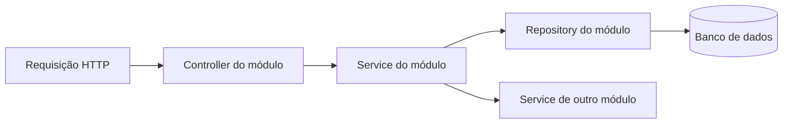

# Arquitetura do backend WMS

O backend segue a organização por módulos de negócio da referência local
`inatback/main`, commit `049ef93737e126c65a856381668fecbe543621bc`.
É uma aplicação Spring Boot com um único processo, um único projeto Maven e um
banco relacional. Os módulos são pacotes Java; não são serviços independentes.

## Como localizar o código

A raiz é `src/main/java/dev/lourencogabriel/wmssaas`. Primeiro se escolhe o
módulo; dentro dele, a camada. Não criar uma pasta global com todas as entidades,
todos os repositórios ou todos os serviços do WMS.

```text
wmssaas/
├── warehouse/
│   ├── controller/   # HTTP dos armazéns, zonas e posições
│   ├── dto/          # Requests, responses e validações de entrada
│   ├── model/        # Warehouse, Zone e Position
│   ├── repository/   # Consultas e bloqueios desses modelos
│   └── service/      # Casos de uso e regras desse módulo
├── product/          # Mesmo padrão para produtos, categorias e embalagens
├── partner/          # Mesmo padrão para clientes e fornecedores
├── ...
├── shared/           # Componentes genéricos reutilizados
└── web/              # Resposta HTTP, erros e filtros transversais
```

Criar cada camada quando houver conteúdo real para ela. Um módulo que por
enquanto contém somente modelos e repositórios não precisa de classes vazias.

| Módulo | Responsabilidade e conteúdo já existente |
| --- | --- |
| `auth` | Login, desafios por e-mail, tokens, bloqueio de conta e autorização. |
| `user` | Usuários, perfis e configuração de permissões. |
| `warehouse` | Armazéns, zonas e posições; seus cadastros e capacidades. |
| `product` | Produtos, categorias e embalagens; seus cadastros e conversões. |
| `partner` | Cadastro de clientes e fornecedores. |
| `order` | Pedido e itens comuns aos fluxos de entrada e saída. |
| `inbound` | Pré-recebimento, conferência, confirmação de recebimento e putaway. |
| `outbound` | Planejamento de saída, ondas, picking e expedição. |
| `stock` | Saldo físico, LPN, reservas, bloqueios e movimentações. |
| `task` | Tarefas operacionais, histórico e divergências. |
| `inventory` | Modelos e repositórios de inventários e seus itens. |
| `audit` | Livro de transações de estoque e proteção de imutabilidade. |
| `operation` | Identificação de operações, idempotência e repetição de resultados. |
| `mail` | Contrato e implementação de envio de e-mails. |
| `shared` | ULID, bases de persistência, paginação e validações genéricas. |
| `web` | `ApiResponse`, tratamento de erros, saúde da API e logs de requisição. |

O pedido tem um módulo próprio porque entrada e saída usam a mesma estrutura.
Ondas e expedições pertencem ao processo de saída. Uma tabela não precisa gerar
um módulo separado: `Zone` e `Position`, por exemplo, pertencem a `warehouse`.

## Responsabilidade das camadas



- **Controller:** declara rota, valida o DTO, aplica a autorização da ação,
  identifica o usuário e delega o caso de uso. Retorna `ApiResponse` e, nas
  listagens, `PageResponse`. Não altera saldo, reserva nem status diretamente.
- **DTO:** concentra o contrato de entrada e saída. Seguir o padrão da referência
  com classes como `ProductDtos` e records de request/response. Não receber ou
  expor uma entidade JPA como contrato de um endpoint novo.
- **Service:** executa o caso de uso, suas RNs e sua transação. Usar injeção por
  construtor, `@Transactional` para escrita e `readOnly = true` para consulta.
  Operações logísticas merecem métodos explícitos, como confirmar e cancelar.
- **Model:** mantém o mapeamento JPA da entidade pertencente ao módulo.
- **Repository:** concentra consultas, persistência e bloqueios. Não contém
  orquestração HTTP ou decisões de negócio.

`config`, `exception`, `security` e outras pastas específicas podem existir
dentro do módulo quando necessárias, como ocorre em `auth`. Não criar uma camada
genérica apenas para acomodar código que já tem um dono de negócio.

## Integração entre módulos

O padrão observado em `inatback/main` permite consultar repositórios de outro
módulo; não há uma fronteira técnica que proíba esses imports. Manter os imports
explícitos e concentrar a escrita com regras no serviço responsável. Não injetar
controllers em serviços nem chamar um controller a partir de outro.

Para continuar os fluxos existentes:

- Reutilizar `stock.service.StockMutationService` nas alterações de saldo,
  movimentações e registros associados. Evitar duplicar esse mecanismo em
  recebimento, picking ou expedição.
- Reutilizar `operation.service.OperationService` para comandos idempotentes.
- Manter a transação do caso de uso abrangendo saldo, reservas, tarefas,
  confirmações e histórico que precisem ser confirmados juntos.
- Seguir a mesma ordem de bloqueios entre fluxos concorrentes. Não transformar
  chamadas entre módulos em transações independentes por conveniência.
- Manter o livro razão e o histórico preservados; correções de estoque são novas
  operações compensatórias, conforme as RNs.
- Novas capacidades de auditoria, tarefas ou inventário ganham seus próprios
  services/DTOs/controllers no módulo correspondente. Há consultas de auditoria e
  tarefas no `StockService` existente; separar esses casos de uso na continuação
  se necessário, preservando o contrato e os limites transacionais.

Não copiar os cadastros educacionais nem as regras de autorização do INAT. A
referência orienta a estrutura do código; as RNs, RFs e RNFs do WMS orientam o
comportamento. Não é necessário introduzir microserviços, múltiplos projetos
Maven ou um framework de módulos para manter esta organização.

## Estado desta reorganização e continuação

Foram distribuídos os modelos e repositórios antes concentrados em `wms`, movidos
os services/DTOs existentes para suas camadas e separados os cadastros por módulo.
As entidades continuam com os mesmos nomes JPA e tabelas; as rotas e regras já
escritas foram preservadas. A reorganização não exige uma migration adicional.

Na validação, foi corrigida a inicialização de `@Version` em `Stock` e
`WarehouseTask`: ela permanece `null` até a primeira persistência, permitindo que
o Spring Data identifique a entidade nova e o Hibernate preencha seu identificador
na própria instância. Os campos e as colunas existentes foram mantidos.

O backend operacional está em desenvolvimento. Ter entidades e services no
pacote não significa que o fluxo esteja concluído ou homologado. Recebimento,
estoque e saída ainda têm integração HTTP pendente; inventário possui a base de
persistência, sem o fluxo completo. A reorganização não conclui essas funções.

### Entrega limitada: APIs de cadastro

A etapa seguinte à reorganização concentra-se nos cadastros de armazéns, zonas,
posições, categorias, produtos, embalagens e parceiros. Categorias e parceiros
passaram a ter as rotas incluídas na política de autorização. As criações usam
HTTP 201 e as respostas dos controllers declaram os DTOs correspondentes.

Os testes de integração desses módulos usam controllers reais, JWTs assinados,
H2 e rollback por teste. Verificam persistência por chamadas HTTP, permissões,
validação, duplicidades e regras de alteração de cadastros com estoque associado.
São evidências específicas dos cadastros relacionados às RF003/RF004 e RN012;
não constituem validação integral dessas regras ou dos fluxos de movimentação.

Os próximos trabalhos permanecem delimitados:

1. Fechar recebimento e putaway com controllers, autorização e testes que sigam
   uma conferência até a armazenagem, incluindo reenvio e falhas transacionais.
2. Integrar consultas e comandos de estoque, transferências, bloqueios e auditoria.
3. Fechar ondas, picking, divergências, cancelamentos e expedição.
4. Implementar contagem e reconciliação de inventário.
5. Validar concorrência em MySQL, backup/restauração e desempenho; integrar os
   clientes e registrar as evidências pendentes do artigo.

As rotas de saúde continuam pendentes de classificação na política HTTP. Esta
entrega não altera o esquema e não requer uma nova migration Flyway.

Na continuação, implementar cada caso de uso completo dentro do módulo:

1. Conferir a RN/RF e o contrato de permissão em `WmsEndpointPolicy`.
2. Criar ou completar DTO, service e controller no módulo responsável.
3. Integrar regras e efeitos transacionais com os serviços existentes.
4. Confirmar que a rota e a segurança de métodos exigem a permissão correta.
5. Testar a regra e suas falhas relevantes, incluindo concorrência/idempotência
   onde houver disputa por saldo. Não usar apenas testes da matriz de permissões
   como prova de que o processo logístico funciona.

Os testes unitários acompanham o pacote do módulo em `src/test/java`. Testes
entre módulos podem ficar em `integration`; `WmsDomainPersistenceTest` verifica
a integração dos modelos, repositórios, mapeamento JPA e migrations.

```bash
./mvnw clean test
```

Testes MySQL que usam Testcontainers dependem de Docker. A execução com H2 valida
o contexto e os mapeamentos, mas não comprova triggers MySQL, concorrência em
produção, desempenho, restauração de backup ou homologação em armazém.

Validação da reorganização em 15/10/2026: 209 testes encontrados, 208 executados
sem falhas e 1 ignorado por indisponibilidade de acesso ao Docker
(`TokenServiceConcurrencyIntegrationTest`). Foram exercitados o contexto Spring,
o mapeamento JPA, as migrations, a persistência operacional e a matriz de segurança.

Validação da entrega de cadastros: 248 testes registrados, 247 sem falhas e 1
MySQL/Testcontainers ignorado; 23 testes novos exercitam APIs reais e 16 casos
adicionais ampliam a matriz de permissões de categorias/parceiros.
