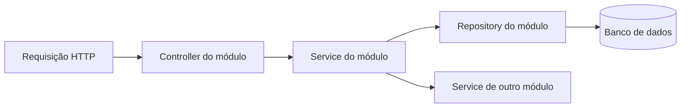

# Arquitetura do backend WMS

O backend segue a organização por módulos de negócio da referência local
`inatback/main`, commit `049ef93737e126c65a856381668fecbe543621bc`.
É uma aplicação Spring Boot com um único processo, um único projeto Maven e um
banco relacional. Os módulos são pacotes Java; não são serviços independentes.

## Como localizar o código

A raiz é `src/main/java/dev/lourencogabriel/wmssaas`. Primeiro se escolhe o
módulo; dentro dele, a camada. Não criar uma pasta global com todas as entidades,
todos os repositórios ou todos os serviços do WMS.

```text
wmssaas/
├── warehouse/
│   ├── controller/   # HTTP dos armazéns, zonas e posições
│   ├── dto/          # Requests, responses e validações de entrada
│   ├── model/        # Warehouse, Zone e Position
│   ├── repository/   # Consultas e bloqueios desses modelos
│   └── service/      # Casos de uso e regras desse módulo
├── product/          # Mesmo padrão para produtos, categorias e embalagens
├── partner/          # Mesmo padrão para clientes e fornecedores
├── ...
├── shared/           # Componentes genéricos reutilizados
└── web/              # Resposta HTTP, erros e filtros transversais
```

Criar cada camada quando houver conteúdo real para ela. Um módulo que por
enquanto contém somente modelos e repositórios não precisa de classes vazias.

| Módulo | Responsabilidade e conteúdo já existente |
| --- | --- |
| `auth` | Login, desafios por e-mail, tokens, bloqueio de conta e autorização. |
| `user` | Usuários, perfis e configuração de permissões. |
| `warehouse` | Armazéns, zonas e posições; seus cadastros e capacidades. |
| `product` | Produtos, categorias e embalagens; seus cadastros e conversões. |
| `partner` | Cadastro de clientes e fornecedores. |
| `order` | Pedido e itens comuns aos fluxos de entrada e saída. |
| `inbound` | Pré-recebimento, conferência, confirmação de recebimento e putaway. |
| `outbound` | Planejamento de saída, ondas, picking e expedição. |
| `stock` | Saldo físico, LPN, reservas, bloqueios e movimentações. |
| `task` | Tarefas operacionais, histórico e divergências. |
| `inventory` | Modelos e repositórios de inventários e seus itens. |
| `audit` | Livro de transações de estoque e proteção de imutabilidade. |
| `operation` | Identificação de operações, idempotência e repetição de resultados. |
| `mail` | Contrato e implementação de envio de e-mails. |
| `shared` | ULID, bases de persistência, paginação e validações genéricas. |
| `web` | `ApiResponse`, tratamento de erros, saúde da API e logs de requisição. |

O pedido tem um módulo próprio porque entrada e saída usam a mesma estrutura.
Ondas e expedições pertencem ao processo de saída. Uma tabela não precisa gerar
um módulo separado: `Zone` e `Position`, por exemplo, pertencem a `warehouse`.

## Responsabilidade das camadas



- **Controller:** declara rota, valida o DTO, aplica a autorização da ação,
  identifica o usuário e delega o caso de uso. Retorna `ApiResponse` e, nas
  listagens, `PageResponse`. Não altera saldo, reserva nem status diretamente.
- **DTO:** concentra o contrato de entrada e saída. Seguir o padrão da referência
  com classes como `ProductDtos` e records de request/response. Não receber ou
  expor uma entidade JPA como contrato de um endpoint novo.
- **Service:** executa o caso de uso, suas RNs e sua transação. Usar injeção por
  construtor, `@Transactional` para escrita e `readOnly = true` para consulta.
  Operações logísticas merecem métodos explícitos, como confirmar e cancelar.
- **Model:** mantém o mapeamento JPA da entidade pertencente ao módulo.
- **Repository:** concentra consultas, persistência e bloqueios. Não contém
  orquestração HTTP ou decisões de negócio.

`config`, `exception`, `security` e outras pastas específicas podem existir
dentro do módulo quando necessárias, como ocorre em `auth`. Não criar uma camada
genérica apenas para acomodar código que já tem um dono de negócio.

## Integração entre módulos

O padrão observado em `inatback/main` permite consultar repositórios de outro
módulo; não há uma fronteira técnica que proíba esses imports. Manter os imports
explícitos e concentrar a escrita com regras no serviço responsável. Não injetar
controllers em serviços nem chamar um controller a partir de outro.

Para continuar os fluxos existentes:

- Reutilizar `stock.service.StockMutationService` nas alterações de saldo,
  movimentações e registros associados. Evitar duplicar esse mecanismo em
  recebimento, picking ou expedição.
- Reutilizar `operation.service.OperationService` para comandos idempotentes.
- Manter a transação do caso de uso abrangendo saldo, reservas, tarefas,
  confirmações e histórico que precisem ser confirmados juntos.
- Seguir a mesma ordem de bloqueios entre fluxos concorrentes. Não transformar
  chamadas entre módulos em transações independentes por conveniência.
- Manter o livro razão e o histórico preservados; correções de estoque são novas
  operações compensatórias, conforme as RNs.
- Novas capacidades de auditoria, tarefas ou inventário ganham seus próprios
  services/DTOs/controllers no módulo correspondente. Há consultas de auditoria e
  tarefas no `StockService` existente; separar esses casos de uso na continuação
  se necessário, preservando o contrato e os limites transacionais.

Não copiar os cadastros educacionais nem as regras de autorização do INAT. A
referência orienta a estrutura do código; as RNs, RFs e RNFs do WMS orientam o
comportamento. Não é necessário introduzir microserviços, múltiplos projetos
Maven ou um framework de módulos para manter esta organização.

## Estado da implementação e validação

Os módulos operacionais possuem controllers, DTOs, services e persistência:
recebimento/conferência e putaway; saldos, bloqueios e transferências; pedidos,
ondas, picking, divergências e expedição; inventário; tarefas e auditoria.
A matriz [REQUISITOS.md](REQUISITOS.md) relaciona as 17 RN, 18 RF e 12 RNF ao código
real e aos testes, sem atribuir ao backend os requisitos de interface Android.

Operações críticas confirmam saldo, reserva, tarefa e histórico na mesma
transação. `OperationService` serializa reenvios pelo ator e usa chave única,
identidade/tipo e hash JSON canônico; objetos são ordenados recursivamente e a
ordem dos arrays é preservada. Não alterar a canonicalização sem considerar as
chaves já persistidas. Dados de desenvolvimento criados por versões anteriores
do hash devem usar uma base nova ou novas chaves para novos comandos.

A ordem de bloqueios é coordenada pelo núcleo de estoque. O bloqueio de armazém
serializa alterações físicas dentro do armazém, e linhas lidas antes da espera
são atualizadas antes de validar sua posição/estado. Essa escolha prioriza
consistência; throughput e duração de ondas ainda precisam de medições de carga.

O inventário mantém snapshot e congela a posição até conclusão/cancelamento.
Pedidos cancelados com mercadoria preparada exigem uma transferência física de
retorno do LPN inteiro, com atualização da quantidade preparada e novo lançamento;
não há retorno fictício por edição de saldo. Correções do livro acrescentam
compensações. Mercadoria já despachada retorna por recebimento documental.

Em entidades com `@Version` gerado, a versão nasce `null` para que o Spring Data
identifique a entidade nova e preencha seu identificador na própria instância.
Migrations de desenvolvimento permanecem consolidadas em V1/V2. Nenhuma migration
incremental foi acrescentada somente pela conclusão dos controllers/serviços.

A suíte possui 315 testes aprovados e nenhum ignorado na validação com Docker,
com API real, JWTs, H2 e dois testes MySQL. Foram verificadas disputa por saldo e
demanda, imutabilidade SQL do livro/histórico, idempotência, rollback, inventário,
retorno e compensação. Backup/restauração também foram executados e conferidos
em MySQL descartável pelo script `ops/verify-backup.sh`.

Os contratos HTTP estão em [OPERACOES.md](OPERACOES.md). Permanecem posteriores:
integração dos clientes; Android/scanners; usabilidade; carga e prazo de feedback;
implantação/supervisão e cron no servidor de destino; homologação em empresa.
Os resultados atuais não demonstram SLA de produção nem tempo de leitura < 2 s.
